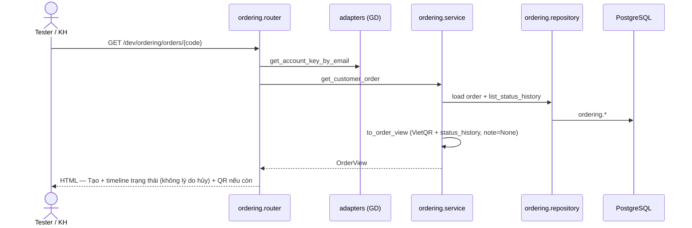

# Sequence — GET /dev/ordering/orders/{code}

UI thử chi tiết đơn (UC-20 xem lại VietQR khi còn hạn + UNPAID).

Ghi chú:

- Timeline dưới thời gian tạo; mỗi lần NV/hệ thống đổi status → thêm mốc `changed_at`.
- KH không thấy `order_status_history_note`; NV xem qua `get_staff_order`.
- Quét VietQR không gọi app. PAID qua SePay (UC-25) /dev giả webhook.
