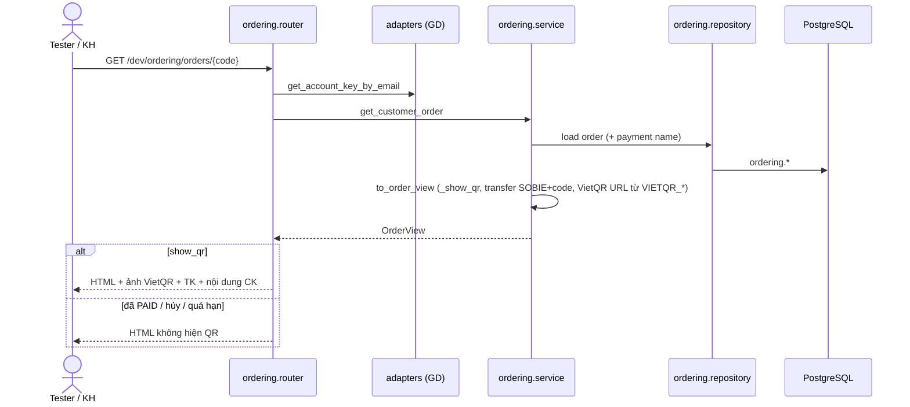

# Sequence — GET /dev/ordering/orders/{code}

UI thử chi tiết đơn (UC-20 xem lại VietQR khi còn hạn + UNPAID).

Ghi chú:

- Quét VietQR **không** gọi app — chỉ giúp KH CK đúng TK/số tiền/nội dung.
- Production: SePay webhook (UC-25) → `mark_order_paid_by_code` → PAID, ẩn QR; đơn vẫn PENDING tới UC-23.
- `/dev`: POST staff «Đánh dấu PAID» giả webhook; chưa implement endpoint SePay.
