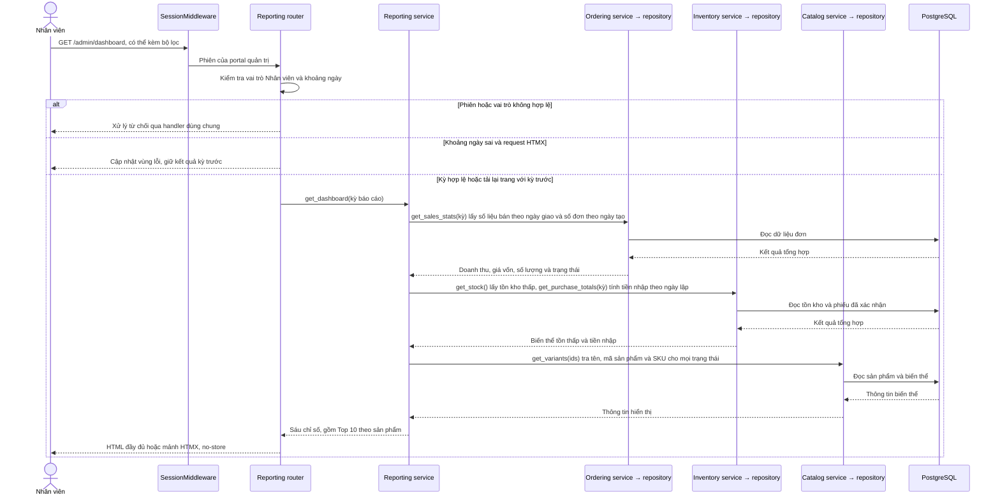

# UC-37 — GET /admin/dashboard

Route phục vụ cả khi mở dashboard và khi lọc theo kỳ. Hai tham số `start_date` và `end_date` nhận ngày dạng `dd/mm/yyyy` hoặc `YYYY-MM-DD`. Khoảng ngày bao gồm cả ngày cuối theo `Asia/Ho_Chi_Minh`.

