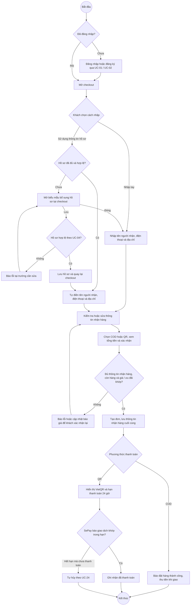

# Sơ đồ activity — Luồng đặt hàng của khách hàng

- **Nguồn:** [BR-GIAIDOAN1](../business-requirements/BR-GIAIDOAN1.md) (BR-003, BR-004, BR-006) và các UC: [UC-18](../use-cases/shopping/UC-18-manage-cart.md), [UC-02](../use-cases/identity/UC-02-login.md), [UC-19](../use-cases/ordering/UC-19-place-order-cod.md), [UC-20](../use-cases/ordering/UC-20-place-order-qr.md), [UC-31](../use-cases/promotion/UC-31-calculate-order-discount.md), [UC-25](../use-cases/payment/UC-25-confirm-bank-transfer.md), [UC-24](../use-cases/ordering/UC-24-auto-cancel-overdue-qr-order.md), [UC-22](../use-cases/ordering/UC-22-cancel-order.md), [UC-23](../use-cases/ordering/UC-23-confirm-order.md), [UC-40](../use-cases/shipping/UC-40-hand-over-to-shipping.md), [UC-36](../use-cases/shipping/UC-36-update-shipment-status.md), [UC-26](../use-cases/ordering/UC-26-issue-invoice.md), [UC-27](../use-cases/ordering/UC-27-view-invoice.md), [UC-35](../use-cases/inventory/UC-35-restock-failed-delivery.md)
- **Ngày lập:** 20/11/2026. Cập nhật luồng checkout ngày 27/11/2026.
- Hình tròn biểu thị bắt đầu hoặc kết thúc, hình chữ nhật biểu thị hoạt động, hình thoi biểu thị điểm rẽ nhánh.

## 1. Đặt hàng và thanh toán

- Đăng ký Google lưu email đã xác minh và định danh Google (`sub`). Đăng ký trực tiếp lưu email đã xác minh và mật khẩu đã băm. Khách có thể bổ sung hồ sơ từ checkout hoặc nhập thông tin riêng cho đơn. Xem [UC-01](../use-cases/identity/UC-01-register-account.md) và [UC-04](../use-cases/identity/UC-04-update-customer-profile.md).

- Khi xác nhận, hệ thống kiểm tra thông tin nhận hàng, tồn kho, giá, mức giảm và nguồn ưu đãi. Nếu xác nhận thất bại, hệ thống báo lỗi và chưa tạo đơn.
- “Tính tổng thanh toán”: khuyến mãi theo sản phẩm luôn áp trên giá từng dòng, sau đó áp thêm **một** trong hai — khuyến mãi theo hóa đơn hoặc voucher, cái lợi hơn (bằng nhau ưu tiên voucher).
- “Khớp”: webhook có API key đúng, mã giao dịch SePay chưa xử lý, nội dung chứa `SOBIE` + mã đơn, đơn QR còn “Chưa xử lý”, “Chưa thanh toán”, còn hạn 24 giờ, số tiền ≥ tổng thanh toán. Chuyển thừa vẫn khớp; chuyển thiếu không khớp, không cộng dồn.

## 2. Xử lý đơn sau khi đặt

Làn: Khách hàng · Hệ thống (website) · Nhân viên · Đơn vị vận chuyển (trang giả lập).

- Khách chỉ hủy được đơn “Chưa xử lý”. Nhân viên hủy được đơn “Chưa xử lý”, “Đã xác nhận”, “Chờ lấy hàng”, bắt buộc nhập lý do; khách không thấy lý do. Từ “Đang giao” trở đi không hủy được.
- Đơn QR quá 24 giờ chưa thanh toán: hệ thống tự hủy (UC-24), cũng kết thúc ở “Đã hủy”.
- Nhân viên chỉ xác nhận được đơn QR đã thanh toán; đơn COD được ghi “Đã thanh toán” khi giao thành công.
- Mọi lần đổi trạng thái đơn đều lưu lịch sử; đổi trạng thái thanh toán không ghi lịch sử.
