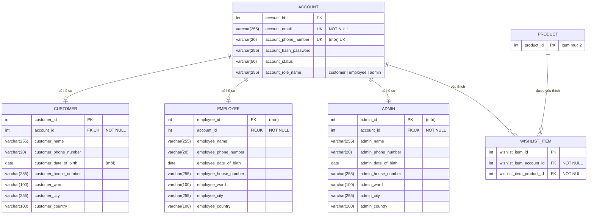
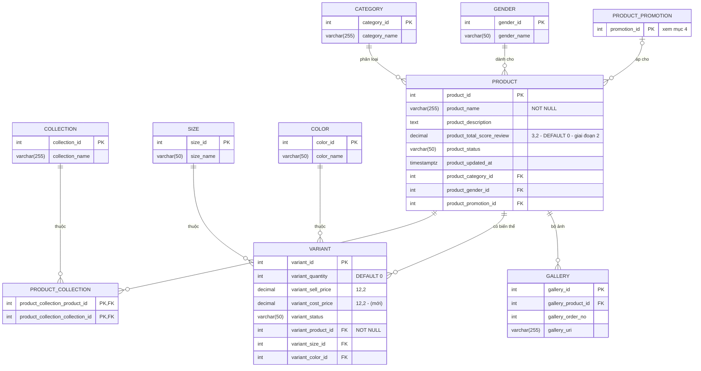
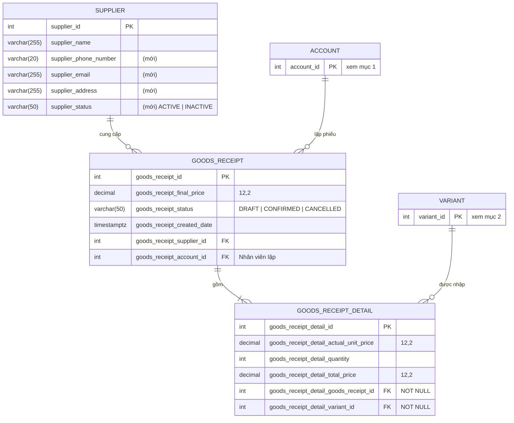
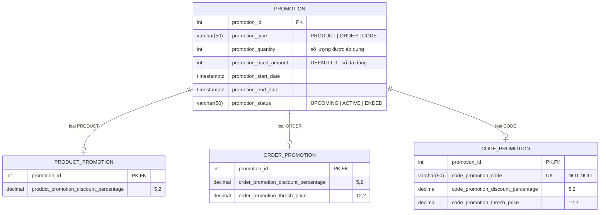

# Data Model v1 — Soobin Swimwear

## Metadata
- **Phiên bản:** v1
- **Status:** draft (chờ developer duyệt)
- **Nguồn:** ERD `sobin_erd_english_formatted.drawio` / `infra/postgres/init.sql`, [entities_model_v1.md](entities_model_v1.md)
- **CSDL:** PostgreSQL — 5 schema: `auth`, `customer`, `inventory`, `promotion`, `sales`

## Chú thích

| Ký hiệu | Ý nghĩa |
|---|---|
| `PK` | Khóa chính (Primary key) |
| `FK` | Khóa ngoại (Foreign key) |
| `UK` | Duy nhất (Unique) |
| `"(mới)"` | Cột / bảng mới so với ERD hiện tại |
| `int`, `varchar(n)`, `decimal`, `date`, `timestamptz`, `text`, `json` | Kiểu dữ liệu. `decimal` ghi kèm độ chính xác trong chú thích, ví dụ `"12,2"` |
| `││──o{` | Một – nhiều (0..n) |
| `││──o│` | Một – không hoặc một (0..1) |

Mọi bảng có khóa chính `int` tự tăng (`GENERATED BY DEFAULT AS IDENTITY`), trừ `product_collection` (khóa ghép) và 3 bảng con của `promotion` (khóa chính đồng thời là khóa ngoại).

## 0. Toàn bộ hệ thống

Sơ đồ gồm cả 28 bảng của 5 schema và mọi quan hệ giữa chúng. Các mục 1 → 5 tách nhỏ theo schema để dễ đọc.

```mermaid
erDiagram
    ACCOUNT {
        int account_id PK
        varchar(255) account_email UK "NOT NULL"
        varchar(20) account_phone_number UK "(mới) UK"
        varchar(255) account_hash_password
        varchar(50) account_status
        varchar(255) account_role_name "customer | employee | admin"
    }
    CUSTOMER {
        int customer_id PK
        int account_id FK, UK "NOT NULL"
        varchar(255) customer_name
        varchar(20) customer_phone_number
        date customer_date_of_birth "(mới)"
        varchar(255) customer_house_number
        varchar(100) customer_ward
        varchar(255) customer_city
        varchar(100) customer_country
    }
    EMPLOYEE {
        int employee_id PK "(mới)"
        int account_id FK, UK "NOT NULL"
        varchar(255) employee_name
        varchar(20) employee_phone_number
        date employee_date_of_birth
        varchar(255) employee_house_number
        varchar(100) employee_ward
        varchar(255) employee_city
        varchar(100) employee_country
    }
    ADMIN {
        int admin_id PK "(mới)"
        int account_id FK, UK "NOT NULL"
        varchar(255) admin_name
        varchar(20) admin_phone_number
        date admin_date_of_birth
        varchar(255) admin_house_number
        varchar(100) admin_ward
        varchar(255) admin_city
        varchar(100) admin_country
    }
    WISHLIST_ITEM {
        int wishlist_item_id PK
        int wishlist_item_account_id FK "NOT NULL"
        int wishlist_item_product_id FK "NOT NULL"
    }
    CATEGORY {
        int category_id PK
        varchar(255) category_name
    }
    COLLECTION {
        int collection_id PK
        varchar(255) collection_name
    }
    GENDER {
        int gender_id PK
        varchar(50) gender_name
    }
    SIZE {
        int size_id PK
        varchar(50) size_name
    }
    COLOR {
        int color_id PK
        varchar(50) color_name
    }
    PRODUCT {
        int product_id PK
        varchar(255) product_name "NOT NULL"
        text product_description
        decimal product_total_score_review "3,2 - DEFAULT 0 - giai đoạn 2"
        varchar(50) product_status
        timestamptz product_updated_at
        int product_category_id FK
        int product_gender_id FK
        int product_promotion_id FK
    }
    PRODUCT_COLLECTION {
        int product_collection_product_id PK, FK
        int product_collection_collection_id PK, FK
    }
    VARIANT {
        int variant_id PK
        int variant_quantity "DEFAULT 0"
        decimal variant_sell_price "12,2"
        decimal variant_cost_price "12,2 - (mới)"
        varchar(50) variant_status
        int variant_product_id FK "NOT NULL"
        int variant_size_id FK
        int variant_color_id FK
    }
    GALLERY {
        int gallery_id PK
        int gallery_product_id FK
        int gallery_order_no
        varchar(255) gallery_uri
    }
    SUPPLIER {
        int supplier_id PK
        varchar(255) supplier_name
        varchar(20) supplier_phone_number "(mới)"
        varchar(255) supplier_email "(mới)"
        varchar(255) supplier_address "(mới)"
        varchar(50) supplier_status "(mới) ACTIVE | INACTIVE"
    }
    GOODS_RECEIPT {
        int goods_receipt_id PK
        decimal goods_receipt_final_price "12,2"
        varchar(50) goods_receipt_status "DRAFT | CONFIRMED | CANCELLED"
        timestamptz goods_receipt_created_date
        int goods_receipt_supplier_id FK
        int goods_receipt_account_id FK "Nhân viên lập"
    }
    GOODS_RECEIPT_DETAIL {
        int goods_receipt_detail_id PK
        decimal goods_receipt_detail_actual_unit_price "12,2"
        int goods_receipt_detail_quantity
        decimal goods_receipt_detail_total_price "12,2"
        int goods_receipt_detail_goods_receipt_id FK "NOT NULL"
        int goods_receipt_detail_variant_id FK "NOT NULL"
    }
    PROMOTION {
        int promotion_id PK
        varchar(50) promotion_type "PRODUCT | ORDER | CODE"
        int promotion_quantity "số lượng được áp dụng"
        int promotion_used_amount "DEFAULT 0 - số đã dùng"
        timestamptz promotion_start_date
        timestamptz promotion_end_date
        varchar(50) promotion_status "UPCOMING | ACTIVE | ENDED"
    }
    PRODUCT_PROMOTION {
        int promotion_id PK, FK
        decimal product_promotion_discount_percentage "5,2"
    }
    ORDER_PROMOTION {
        int promotion_id PK, FK
        decimal order_promotion_discount_percentage "5,2"
        decimal order_promotion_thresh_price "12,2"
    }
    CODE_PROMOTION {
        int promotion_id PK, FK
        varchar(50) code_promotion_code UK "NOT NULL"
        decimal code_promotion_discount_percentage "5,2"
        decimal code_promotion_thresh_price "12,2"
    }
    CART {
        int cart_id PK
        int cart_account_id FK, UK "NOT NULL - tham chiếu customer.customer_id"
    }
    CART_ITEM {
        int cart_item_id PK
        int cart_item_quantity "DEFAULT 1"
        int cart_item_cart_id FK "NOT NULL"
        int cart_item_variant_id FK "NOT NULL"
    }
    PAYMENT {
        int payment_id PK
        varchar(100) payment_name "COD | QR"
    }
    ORDER {
        int order_id PK
        varchar(8) order_code UK "(mới) NOT NULL - 8 ký tự Crockford Base32, dùng trong nội dung chuyển khoản"
        varchar(255) order_customer_name
        varchar(20) order_customer_phone_number
        varchar(255) order_customer_house_number
        varchar(100) order_customer_ward
        varchar(255) order_customer_city
        varchar(100) order_customer_country
        decimal order_discount_amount "12,2"
        decimal order_shipping_fee "12,2"
        decimal order_total_price "12,2"
        varchar(50) order_payment_status "UNPAID | PAID"
        varchar(50) order_status "PENDING | CONFIRMED | AWAITING_PICKUP | SHIPPING | DELIVERED | DELIVERY_FAILED | CANCELLED"
        timestamptz order_created_date
        int order_account_id FK
        int order_payment_id FK
        int order_promotion_id FK "KM hóa đơn hoặc voucher"
    }
    ORDER_DETAIL {
        int order_detail_id PK
        decimal order_detail_unit_price "12,2 - đơn giá gốc"
        int order_detail_quantity
        int order_detail_order_id FK "NOT NULL"
        int order_detail_variant_id FK "NOT NULL"
        int order_detail_product_promotion_id FK
    }
    INVOICE {
        int invoice_id PK
        int invoice_order_id FK, UK "NOT NULL"
        json invoice_snapshot_json
        timestamptz invoice_created_date
    }
    BANK_TRANSACTION {
        int bank_transaction_id PK "(mới)"
        varchar(100) bank_transaction_provider_id UK "NOT NULL - mã giao dịch của SePay, chống xử lý trùng"
        varchar(100) bank_transaction_gateway "tên ngân hàng"
        varchar(50) bank_transaction_account_number "tài khoản nhận"
        decimal bank_transaction_amount "12,2 - số tiền vào"
        text bank_transaction_content "nội dung chuyển khoản"
        varchar(100) bank_transaction_reference_code "mã tham chiếu ngân hàng"
        timestamptz bank_transaction_time "thời điểm giao dịch tại ngân hàng"
        timestamptz bank_transaction_received_time "thời điểm website nhận webhook"
        varchar(50) bank_transaction_match_status "MATCHED | UNMATCHED"
        int bank_transaction_order_id FK "NULL khi không khớp được mã đơn"
        json bank_transaction_raw_payload "payload webhook gốc"
    }
    ORDER_STATUS_HISTORY {
        int order_status_history_id PK
        int order_status_history_order_id FK "NOT NULL"
        varchar(50) order_status_history_from_value
        varchar(50) order_status_history_to_value
        varchar(50) order_status_history_source
        text order_status_history_note "(mới) - lý do hủy do Nhân viên nhập; chỉ Nhân viên xem"
        int order_status_history_changed_by FK
        timestamptz order_status_history_changed_time
    }

    ACCOUNT ||--o| CUSTOMER : "có hồ sơ"
    ACCOUNT ||--o| EMPLOYEE : "có hồ sơ"
    ACCOUNT ||--o| ADMIN : "có hồ sơ"
    ACCOUNT ||--o{ WISHLIST_ITEM : "yêu thích"
    PRODUCT ||--o{ WISHLIST_ITEM : "được yêu thích"
    CATEGORY ||--o{ PRODUCT : "phân loại"
    GENDER ||--o{ PRODUCT : "dành cho"
    PRODUCT_PROMOTION |o--o{ PRODUCT : "áp cho"
    PRODUCT ||--o{ PRODUCT_COLLECTION : "thuộc"
    COLLECTION ||--o{ PRODUCT_COLLECTION : "thuộc"
    PRODUCT ||--o{ VARIANT : "có biến thể"
    SIZE ||--o{ VARIANT : "thuộc"
    COLOR ||--o{ VARIANT : "thuộc"
    PRODUCT ||--o{ GALLERY : "bộ ảnh"
    SUPPLIER ||--o{ GOODS_RECEIPT : "cung cấp"
    ACCOUNT ||--o{ GOODS_RECEIPT : "lập phiếu"
    GOODS_RECEIPT ||--|{ GOODS_RECEIPT_DETAIL : "gồm"
    VARIANT ||--o{ GOODS_RECEIPT_DETAIL : "được nhập"
    PROMOTION ||--o| PRODUCT_PROMOTION : "loại PRODUCT"
    PROMOTION ||--o| ORDER_PROMOTION : "loại ORDER"
    PROMOTION ||--o| CODE_PROMOTION : "loại CODE"
    CUSTOMER ||--o| CART : "có giỏ"
    CART ||--o{ CART_ITEM : "gồm"
    VARIANT ||--o{ CART_ITEM : "thuộc"
    ACCOUNT ||--o{ ORDER : "đặt"
    PAYMENT ||--o{ ORDER : "thanh toán bằng"
    PROMOTION |o--o{ ORDER : "áp dụng"
    ORDER ||--|{ ORDER_DETAIL : "gồm"
    VARIANT ||--o{ ORDER_DETAIL : "thuộc"
    PRODUCT_PROMOTION |o--o{ ORDER_DETAIL : "giảm giá dòng"
    ORDER ||--o| INVOICE : "xuất"
    ORDER ||--o{ ORDER_STATUS_HISTORY : "lịch sử"
    ORDER |o--o{ BANK_TRANSACTION : "nhận tiền"
    ACCOUNT |o--o{ ORDER_STATUS_HISTORY : "người đổi"
```

## 1. auth + customer — Tài khoản và hồ sơ

| Bảng | Schema | Ràng buộc khác |
|---|---|---|
| `account` | `auth` | Bỏ `account_name`, `account_date_of_birth`, `account_house_number`, `account_ward`, `account_city`, `account_country` (chuyển sang hồ sơ) |
| `customer` | `customer` | `account_id` → `auth.account.account_id` |
| `employee` (mới) | `auth` | `account_id` → `auth.account.account_id` |
| `admin` (mới) | `auth` | `account_id` → `auth.account.account_id` |
| `wishlist_item` | `customer` | UNIQUE (`wishlist_item_account_id`, `wishlist_item_product_id`) |

## 2. inventory — Sản phẩm và biến thể

## 3. inventory — Nhà cung cấp và phiếu nhập

## 4. promotion — Khuyến mãi

## 5. sales — Giỏ hàng, đơn hàng, hóa đơn

```mermaid
erDiagram
    CART {
        int cart_id PK
        int cart_account_id FK, UK "NOT NULL - tham chiếu customer.customer_id"
    }
    CART_ITEM {
        int cart_item_id PK
        int cart_item_quantity "DEFAULT 1"
        int cart_item_cart_id FK "NOT NULL"
        int cart_item_variant_id FK "NOT NULL"
    }
    PAYMENT {
        int payment_id PK
        varchar(100) payment_name "COD | QR"
    }
    ORDER {
        int order_id PK
        varchar(8) order_code UK "(mới) NOT NULL - 8 ký tự Crockford Base32, dùng trong nội dung chuyển khoản"
        varchar(255) order_customer_name
        varchar(20) order_customer_phone_number
        varchar(255) order_customer_house_number
        varchar(100) order_customer_ward
        varchar(255) order_customer_city
        varchar(100) order_customer_country
        decimal order_discount_amount "12,2"
        decimal order_shipping_fee "12,2"
        decimal order_total_price "12,2"
        varchar(50) order_payment_status "UNPAID | PAID"
        varchar(50) order_status "PENDING | CONFIRMED | AWAITING_PICKUP | SHIPPING | DELIVERED | DELIVERY_FAILED | CANCELLED"
        timestamptz order_created_date
        int order_account_id FK
        int order_payment_id FK
        int order_promotion_id FK "KM hóa đơn hoặc voucher"
    }
    ORDER_DETAIL {
        int order_detail_id PK
        decimal order_detail_unit_price "12,2 - đơn giá gốc"
        int order_detail_quantity
        int order_detail_order_id FK "NOT NULL"
        int order_detail_variant_id FK "NOT NULL"
        int order_detail_product_promotion_id FK
    }
    INVOICE {
        int invoice_id PK
        int invoice_order_id FK, UK "NOT NULL"
        json invoice_snapshot_json
        timestamptz invoice_created_date
    }
    BANK_TRANSACTION {
        int bank_transaction_id PK "(mới)"
        varchar(100) bank_transaction_provider_id UK "NOT NULL - mã giao dịch của SePay, chống xử lý trùng"
        varchar(100) bank_transaction_gateway "tên ngân hàng"
        varchar(50) bank_transaction_account_number "tài khoản nhận"
        decimal bank_transaction_amount "12,2 - số tiền vào"
        text bank_transaction_content "nội dung chuyển khoản"
        varchar(100) bank_transaction_reference_code "mã tham chiếu ngân hàng"
        timestamptz bank_transaction_time "thời điểm giao dịch tại ngân hàng"
        timestamptz bank_transaction_received_time "thời điểm website nhận webhook"
        varchar(50) bank_transaction_match_status "MATCHED | UNMATCHED"
        int bank_transaction_order_id FK "NULL khi không khớp được mã đơn"
        json bank_transaction_raw_payload "payload webhook gốc"
    }
    ORDER_STATUS_HISTORY {
        int order_status_history_id PK
        int order_status_history_order_id FK "NOT NULL"
        varchar(50) order_status_history_from_value
        varchar(50) order_status_history_to_value
        varchar(50) order_status_history_source
        text order_status_history_note "(mới) - lý do hủy do Nhân viên nhập; chỉ Nhân viên xem"
        int order_status_history_changed_by FK
        timestamptz order_status_history_changed_time
    }
    CUSTOMER {
        int customer_id PK "xem mục 1"
    }
    ACCOUNT {
        int account_id PK "xem mục 1"
    }
    VARIANT {
        int variant_id PK "xem mục 2"
    }
    PROMOTION {
        int promotion_id PK "xem mục 4"
    }
    PRODUCT_PROMOTION {
        int promotion_id PK "xem mục 4"
    }

    CUSTOMER ||--o| CART : "có giỏ"
    CART ||--o{ CART_ITEM : "gồm"
    VARIANT ||--o{ CART_ITEM : "thuộc"
    ACCOUNT ||--o{ ORDER : "đặt"
    PAYMENT ||--o{ ORDER : "thanh toán bằng"
    PROMOTION |o--o{ ORDER : "áp dụng"
    ORDER ||--|{ ORDER_DETAIL : "gồm"
    VARIANT ||--o{ ORDER_DETAIL : "thuộc"
    PRODUCT_PROMOTION |o--o{ ORDER_DETAIL : "giảm giá dòng"
    ORDER ||--o| INVOICE : "xuất"
    ORDER ||--o{ ORDER_STATUS_HISTORY : "lịch sử"
    ORDER |o--o{ BANK_TRANSACTION : "nhận tiền"
    ACCOUNT |o--o{ ORDER_STATUS_HISTORY : "người đổi"
```

| Bảng | Ràng buộc khác |
|---|---|
| `cart_item` | UNIQUE (`cart_item_cart_id`, `cart_item_variant_id`) |
| `order` | `order_code` UNIQUE, CHECK `order_code ~ '^[0-9A-HJKMNP-TV-Z]{8}$'` (Crockford Base32, bỏ I, L, O, U); sinh bằng `secrets`, trùng thì sinh lại. `order_shipping_fee` lấy từ biến môi trường phí vận chuyển (mặc định 12.000đ) tại thời điểm đặt |
| `bank_transaction` | `bank_transaction_provider_id` UNIQUE. Ghi giao dịch và cập nhật `order_payment_status` trong cùng transaction. Chỉ `MATCHED` khi nội dung chứa `SOBIE` + `order_code` của đơn QR `PENDING`, `UNPAID`, còn hạn 24 giờ và số tiền ≥ `order_total_price`; mỗi giao dịch xét riêng, không cộng dồn |
| `invoice` | `invoice_snapshot_json`: tên sản phẩm, đơn giá gốc, đơn giá sau giảm, số lượng, tiền giảm, phí vận chuyển, tổng thanh toán, địa chỉ, người đặt, SĐT, email, phương thức thanh toán |

## 6. Thay đổi so với ERD / `init.sql` hiện tại

| # | Bảng | Thay đổi | Căn cứ |
|---|---|---|---|
| 1 | `auth.account` | Bỏ 6 cột thông tin cá nhân; `account_phone_number` thêm UNIQUE | Đã chốt (BR-001) |
| 2 | `customer.customer` | Thêm `customer_date_of_birth date` | Đã chốt (BR-001) |
| 3 | `auth.employee`, `auth.admin` | Bảng mới, cấu trúc giống `customer.customer` | Đã chốt (BR-001) |
| 4 | `inventory.variant` | Thêm `variant_cost_price decimal(12,2)` | Đã chốt (BR-005, BR-007) |
| 5 | `inventory.supplier` | Thêm `supplier_phone_number`, `supplier_email`, `supplier_address`, `supplier_status` | Đã chốt (UC-32, UC-33) |
| 6 | Mọi cột thời gian | `datetime` → `timestamptz` | PostgreSQL không có kiểu `datetime`; AGENTS.md yêu cầu lưu thời gian UTC bằng `timestamptz` |
| 7 | `customer.customer` ↔ `auth.account` | Sửa hướng khóa ngoại: `customer.account_id` → `auth.account.account_id` | `init.sql` đang khai báo ngược (`account.account_id` → `customer.account_id`) |
| 8 | `sales.order` | Thêm `order_code varchar(8)` UNIQUE, NOT NULL | Đã chốt 20/11/2026 (BR-006, mã đơn Crockford Base32) |
| 9 | `sales.order` | `order_status`: thêm `AWAITING_PICKUP` (Chờ lấy hàng), bỏ `REJECTED` (Bị từ chối) | Đã chốt 20/11/2026 (BR-003, BR-006) |
| 10 | `sales.order_status_history` | Thêm `order_status_history_note text` lưu lý do hủy của Nhân viên | Đã chốt 20/11/2026 (BR-003); vị trí lưu là `[GD]` |
| 11 | `sales.bank_transaction` | Bảng mới lưu giao dịch nhận từ webhook SePay (khớp hoặc không khớp) | Đã chốt 20/11/2026 (BR-006); danh sách cột là `[GD]` |

## 7. Lưu ý cho developer

- **`init.sql` hiện không chạy được trên PostgreSQL** vì dùng kiểu `datetime` (thay đổi #6) và khóa ngoại `account → customer` bị ngược (thay đổi #7). Cần sửa khi cập nhật migration.
- `cart.cart_account_id` giữ theo ERD: tham chiếu `customer.customer_id` (tên cột gợi ý account nhưng thực tế là customer).
- Giá trị trạng thái trong chú thích (`PENDING`, `ACTIVE`…) là mã đề xuất `[GD]` — xem mục 6 của [entities_model_v1.md](entities_model_v1.md).
- Quy tắc nghiệp vụ (giá vốn bình quân gia quyền, giá theo size, khuyến mãi không sửa…) nằm ở [entities_model_v1.md](entities_model_v1.md), không lặp lại ở đây.

## History
- v1 (2026-11-15): initial — data model vật lý dựng từ ERD + entities_model_v1
- v1.1 (2026-11-15): thêm sơ đồ toàn bộ hệ thống (mục 0)
- v1.2 (2026-11-20): theo BR-GIAIDOAN1 v15 — thêm `order_code`, trạng thái `AWAITING_PICKUP`, bỏ `REJECTED`, thêm `order_status_history_note`, bảng `bank_transaction` cho webhook SePay
