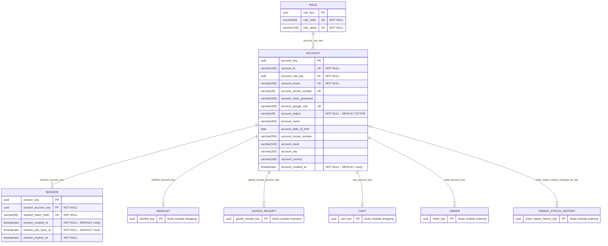
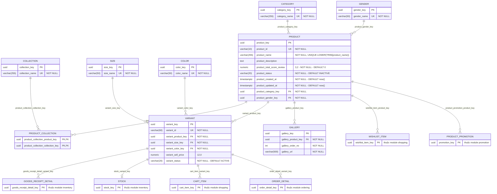
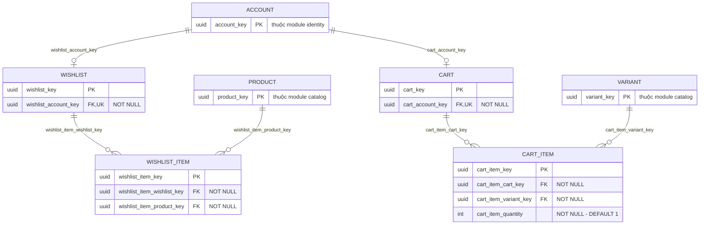
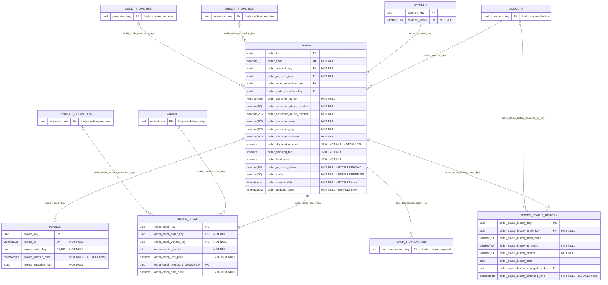
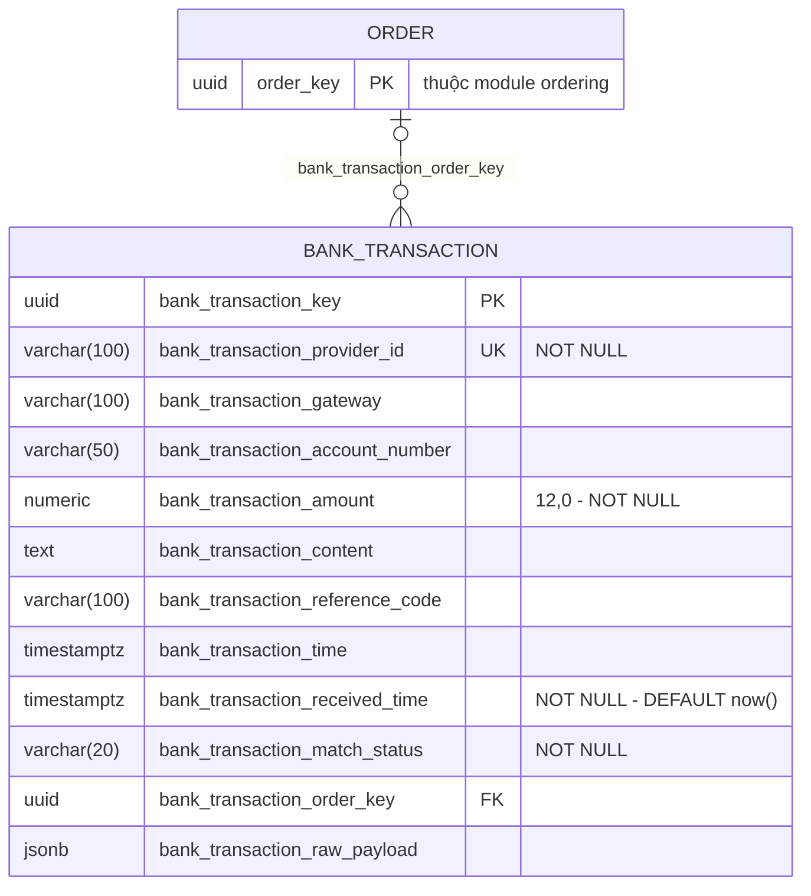
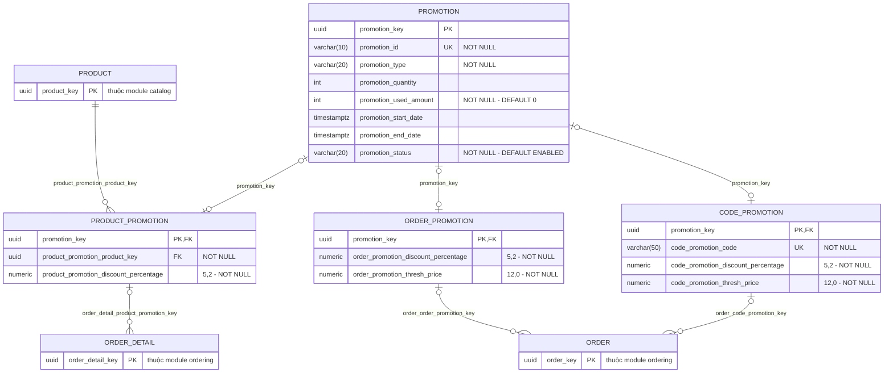
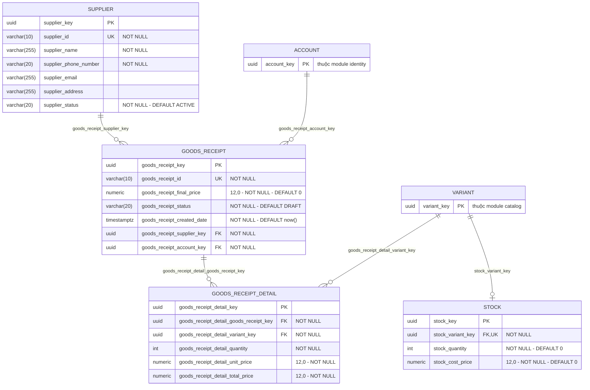

# Data Model v2 — Soobin Swimwear

> Bản vẽ Mermaid của [data_model_v2.dbml](data_model_v2.dbml), cập nhật ngày 27/11/2026 — **nguồn chính là file DBML**; khi đổi data model, sửa file DBML trước rồi cập nhật file này cho khớp. Changelog và câu hỏi mở nằm ở cuối file DBML.

## Quy ước

```text
 Quy ước chung:
   - Tiền: số nguyên VND -> numeric(12,0) (map sang Decimal), ROUND_HALF_UP.
   - Phần trăm giảm: numeric(5,2), 0 < x < 100.
   - Thời gian: timestamptz, lưu UTC.
   - Khóa chính (đã chốt):
       * Mọi bảng dùng khóa chính uuid, tên cột có hậu tố _key,
         default gen_random_uuid(). Mọi khóa ngoại cũng là uuid, hậu tố _key.
       * Bảng nối product_collection dùng PK ghép từ 2 khóa ngoại;
         3 bảng con của promotion dùng promotion_key làm PK + FK.
   - Mã tự nhiên (đã chốt): 7 bảng account, supplier, product, variant,
     goods_receipt, promotion, invoice có thêm cột <x>_id
     varchar, NOT NULL, UNIQUE — hệ thống tự cấp, không cho sửa.
     Phần "4 số" là bộ đếm tăng dần 0001 -> 0002 -> ... (không đếm lại theo ngày
     hay theo họ tên): chung cho cả bảng, riêng account đếm theo từng tiền tố
     KH, NV, AD. Trường hợp vượt 9999: chưa xử lý.
       * Tài khoản Nhân viên : NV-<HỌ TÊN>-<YYYYMMDD ngày sinh>-<4 số>
       * Tài khoản Admin     : AD-<HỌ TÊN>-<YYYYMMDD ngày sinh>-<4 số>
       * Tài khoản Khách hàng: KH-<YYYYMMDD ngày đăng ký>-<4 số>
         (đổi vai trò NV <-> AD thì cấp mã mới — ngoại lệ duy nhất của "không sửa")
       * NCC       : NCC-<4 số>
       * Sản phẩm  : SP-<4 số>
       * Biến thể  : <mã SP>-<MÀU>-<SIZE> (không có bộ đếm)
       * Phiếu nhập: PN-<4 số>
       * Khuyến mãi: KM-<4 số> (cả 3 loại dùng chung bộ đếm)
       * Hóa đơn   : HD-<order_code> (không có bộ đếm, 1 đơn 1 hóa đơn)
     <HỌ TÊN>, <MÀU>, <SIZE>: bỏ dấu (Đ -> D), viết hoa, bỏ khoảng trắng.
   - Module (đã chốt 20/11/2026): 1 module = 1 schema PostgreSQL = 1 TableGroup
     = 1 thư mục specs/use-cases/<module>/ = 1 package app/modules/<module>/.
       identity  : role, account, shipping_address, session
       catalog   : category, collection, gender, size, color, product,
                   product_collection, variant, gallery
       shopping  : cart, cart_item, wishlist, wishlist_item
       ordering  : payment (phương thức), order, order_detail,
                   order_status_history, invoice
       payment   : bank_transaction
       promotion : promotion, product_promotion, order_promotion, code_promotion
       inventory : supplier, goods_receipt, goods_receipt_detail, stock
       shipping, reporting, notification: không có bảng.
     Khóa ngoại giữa 2 schema vẫn khai báo ở DB để giữ toàn vẹn dữ liệu, nhưng code
     của module chỉ đọc / ghi bảng của chính nó; cần dữ liệu module khác thì gọi
     service công khai của module đó (AGENTS.md).
```

**Ký hiệu trong sơ đồ Mermaid**

| Ký hiệu | Ý nghĩa |
|---|---|
| `PK` / `FK` / `UK` | Khóa chính / khóa ngoại / duy nhất |
| `numeric` + chú thích `12,0` | `numeric(12,0)` — Mermaid không cho dấu phẩy trong kiểu |
| `NOT NULL`, `DEFAULT` | Ràng buộc cột (cột không ghi `NOT NULL` là cho phép NULL) |
| `\|\|--o{` | Một – nhiều (0..n) |
| `\|\|--o\|` | Một – không hoặc một (0..1) |
| `\|o--o{` | Khóa ngoại cho phép NULL: không hoặc một – nhiều |

Tên entity trong sơ đồ là tên bảng viết hoa; schema (= module) ghi ở tiêu đề từng mục. Sơ đồ module chỉ vẽ bảng của module đó; bảng của module khác chỉ hiện khóa chính (ghi "thuộc module ...").

## 0. Toàn hệ thống

30 bảng, 36 quan hệ, 7 module có bảng (`shipping`, `reporting`, `notification` không có bảng). Sơ đồ này chỉ vẽ khóa chính, khóa ngoại và mã tự nhiên; cột đầy đủ xem các mục theo module.

```mermaid
erDiagram
    ROLE {
        uuid role_key PK
    }
    ACCOUNT {
        uuid account_key PK
        varchar(100) account_id UK "NOT NULL"
        uuid account_role_key FK "NOT NULL"
    }
    SESSION {
        uuid session_key PK
        uuid session_account_key FK "NOT NULL"
        varchar(64) session_token_hash UK "NOT NULL"
    }
    CATEGORY {
        uuid category_key PK
    }
    COLLECTION {
        uuid collection_key PK
    }
    GENDER {
        uuid gender_key PK
    }
    SIZE {
        uuid size_key PK
    }
    COLOR {
        uuid color_key PK
    }
    PRODUCT {
        uuid product_key PK
        varchar(10) product_id UK "NOT NULL"
        uuid product_category_key FK "NOT NULL"
        uuid product_gender_key FK "NOT NULL"
    }
    PRODUCT_COLLECTION {
        uuid product_collection_product_key PK, FK
        uuid product_collection_collection_key PK, FK
    }
    VARIANT {
        uuid variant_key PK
        varchar(60) variant_id UK "NOT NULL"
        uuid variant_product_key FK "NOT NULL"
        uuid variant_size_key FK "NOT NULL"
        uuid variant_color_key FK "NOT NULL"
    }
    GALLERY {
        uuid gallery_key PK
        uuid gallery_product_key FK "NOT NULL"
    }
    WISHLIST {
        uuid wishlist_key PK
        uuid wishlist_account_key FK, UK "NOT NULL"
    }
    WISHLIST_ITEM {
        uuid wishlist_item_key PK
        uuid wishlist_item_wishlist_key FK "NOT NULL"
        uuid wishlist_item_product_key FK "NOT NULL"
    }
    SUPPLIER {
        uuid supplier_key PK
        varchar(10) supplier_id UK "NOT NULL"
    }
    GOODS_RECEIPT {
        uuid goods_receipt_key PK
        varchar(10) goods_receipt_id UK "NOT NULL"
        uuid goods_receipt_supplier_key FK "NOT NULL"
        uuid goods_receipt_account_key FK "NOT NULL"
    }
    GOODS_RECEIPT_DETAIL {
        uuid goods_receipt_detail_key PK
        uuid goods_receipt_detail_goods_receipt_key FK "NOT NULL"
        uuid goods_receipt_detail_variant_key FK "NOT NULL"
    }
    STOCK {
        uuid stock_key PK
        uuid stock_variant_key FK, UK "NOT NULL"
    }
    PROMOTION {
        uuid promotion_key PK
        varchar(10) promotion_id UK "NOT NULL"
    }
    PRODUCT_PROMOTION {
        uuid promotion_key PK, FK
        uuid product_promotion_product_key FK "NOT NULL"
    }
    ORDER_PROMOTION {
        uuid promotion_key PK, FK
    }
    CODE_PROMOTION {
        uuid promotion_key PK, FK
    }
    CART {
        uuid cart_key PK
        uuid cart_account_key FK, UK "NOT NULL"
    }
    CART_ITEM {
        uuid cart_item_key PK
        uuid cart_item_cart_key FK "NOT NULL"
        uuid cart_item_variant_key FK "NOT NULL"
    }
    PAYMENT {
        uuid payment_key PK
    }
    ORDER {
        uuid order_key PK
        uuid order_account_key FK "NOT NULL"
        uuid order_payment_key FK "NOT NULL"
        uuid order_order_promotion_key FK
        uuid order_code_promotion_key FK
    }
    ORDER_DETAIL {
        uuid order_detail_key PK
        uuid order_detail_order_key FK "NOT NULL"
        uuid order_detail_variant_key FK "NOT NULL"
        uuid order_detail_product_promotion_key FK
    }
    ORDER_STATUS_HISTORY {
        uuid order_status_history_key PK
        uuid order_status_history_order_key FK "NOT NULL"
        uuid order_status_history_changed_by_key FK
    }
    INVOICE {
        uuid invoice_key PK
        varchar(11) invoice_id UK "NOT NULL"
        uuid invoice_order_key FK, UK "NOT NULL"
    }
    BANK_TRANSACTION {
        uuid bank_transaction_key PK
        varchar(100) bank_transaction_provider_id UK "NOT NULL"
        uuid bank_transaction_order_key FK
    }

    ROLE ||--o{ ACCOUNT : "account_role_key"
    ACCOUNT ||--o{ SESSION : "session_account_key"
    CATEGORY ||--o{ PRODUCT : "product_category_key"
    GENDER ||--o{ PRODUCT : "product_gender_key"
    PRODUCT ||--o{ PRODUCT_COLLECTION : "product_collection_product_key"
    COLLECTION ||--o{ PRODUCT_COLLECTION : "product_collection_collection_key"
    PRODUCT ||--o{ VARIANT : "variant_product_key"
    SIZE ||--o{ VARIANT : "variant_size_key"
    COLOR ||--o{ VARIANT : "variant_color_key"
    PRODUCT ||--o{ GALLERY : "gallery_product_key"
    ACCOUNT ||--o| WISHLIST : "wishlist_account_key"
    WISHLIST ||--o{ WISHLIST_ITEM : "wishlist_item_wishlist_key"
    PRODUCT ||--o{ WISHLIST_ITEM : "wishlist_item_product_key"
    SUPPLIER ||--o{ GOODS_RECEIPT : "goods_receipt_supplier_key"
    ACCOUNT ||--o{ GOODS_RECEIPT : "goods_receipt_account_key"
    GOODS_RECEIPT ||--o{ GOODS_RECEIPT_DETAIL : "goods_receipt_detail_goods_receipt_key"
    VARIANT ||--o{ GOODS_RECEIPT_DETAIL : "goods_receipt_detail_variant_key"
    VARIANT ||--o| STOCK : "stock_variant_key"
    PROMOTION |o--o| PRODUCT_PROMOTION : "promotion_key"
    PROMOTION |o--o| ORDER_PROMOTION : "promotion_key"
    PROMOTION |o--o| CODE_PROMOTION : "promotion_key"
    PRODUCT ||--o{ PRODUCT_PROMOTION : "product_promotion_product_key"
    ACCOUNT ||--o| CART : "cart_account_key"
    CART ||--o{ CART_ITEM : "cart_item_cart_key"
    VARIANT ||--o{ CART_ITEM : "cart_item_variant_key"
    ACCOUNT ||--o{ ORDER : "order_account_key"
    PAYMENT ||--o{ ORDER : "order_payment_key"
    ORDER_PROMOTION |o--o{ ORDER : "order_order_promotion_key"
    CODE_PROMOTION |o--o{ ORDER : "order_code_promotion_key"
    ORDER ||--o{ ORDER_DETAIL : "order_detail_order_key"
    VARIANT ||--o{ ORDER_DETAIL : "order_detail_variant_key"
    PRODUCT_PROMOTION |o--o{ ORDER_DETAIL : "order_detail_product_promotion_key"
    ORDER ||--o{ ORDER_STATUS_HISTORY : "order_status_history_order_key"
    ACCOUNT |o--o{ ORDER_STATUS_HISTORY : "order_status_history_changed_by_key"
    ORDER ||--o| INVOICE : "invoice_order_key"
    ORDER |o--o{ BANK_TRANSACTION : "bank_transaction_order_key"
```



## 1. identity — vai trò, tài khoản, phiên đăng nhập (BR-001)

Schema PostgreSQL: `identity`. Use case: [specs/use-cases/identity/](../use-cases/identity/).



### `identity.role`

| Cột | Kiểu | Khóa | Ràng buộc | Ghi chú |
|---|---|---|---|---|
| `role_key` | `uuid` | PK | DEFAULT `gen_random_uuid()` | [KEY] |
| `role_code` | `varchar(50)` | UK | NOT NULL | customer \| employee \| admin — code dùng để kiểm tra quyền |
| `role_name` | `varchar(100)` | UK | NOT NULL | Khách hàng \| Nhân viên \| Admin — tên hiển thị |

**Ghi chú**

```text
[RBAC] Bảng vai trò. Seed sẵn 3 dòng cố định; không có chức năng tạo / sửa /
xóa vai trò (BR: Out of Scope "Tạo vai trò mới hoặc cấu hình quyền").
Chưa có bảng permission: quyền của từng vai trò kiểm tra theo role_code
trong code (ví dụ chỉ employee xem dashboard, chỉ admin quản lý tài khoản).
Khi cần, thêm identity.permission và identity.role_permission (N-N) mà không đổi bảng này.
```

### `identity.account`

| Cột | Kiểu | Khóa | Ràng buộc | Ghi chú |
|---|---|---|---|---|
| `account_key` | `uuid` | PK | DEFAULT `gen_random_uuid()` | [KEY] |
| `account_id` | `varchar(100)` | UK | NOT NULL | [KEY][MOI] mã tự nhiên theo vai trò, hệ thống cấp (chuyển từ customer_id / employee_id / admin_id). KH-<YYYYMMDD ngày đăng ký>-<4 số>; NV- / AD-<HỌ TÊN>-<YYYYMMDD ngày sinh>-<4 số>. Bộ đếm 4 số riêng cho từng tiền tố KH, NV, AD. Không sửa, trừ khi đổi vai trò NV <-> AD thì cấp mã mới (Q16, Q32). Ngày đăng ký lấy theo giờ Asia/Ho_Chi_Minh (đã chốt 21/11/2026). |
| `account_role_key` | `uuid` | FK | NOT NULL | → `identity.role.role_key`. [RBAC] mỗi tài khoản đúng 1 vai trò (đã chốt Q17) |
| `account_email` | `varchar(255)` | UK | NOT NULL | [MOI] đăng nhập bằng email |
| `account_phone_number` | `varchar(20)` | UK | NULL với Khách hàng | Khách bổ sung số điện thoại ở UC-04. Nhân viên và Admin phải có số điện thoại. |
| `account_hash_password` | `varchar(255)` |  | NULL với tài khoản chỉ dùng Google | Mật khẩu Sobie được băm bằng bcrypt. Mỗi tài khoản phải có hash mật khẩu hoặc định danh Google. |
| `account_google_sub` | `varchar(255)` | UK | NULL khi chưa liên kết | Định danh Google duy nhất cho tài khoản Khách hàng. Sobie lưu định danh này khi tạo tài khoản qua Google hoặc khi liên kết lần đầu với tài khoản Khách hàng đang Hoạt động có email trùng với email đã được Google xác minh (UC-01, UC-02). |
| `account_status` | `varchar(20)` |  | NOT NULL DEFAULT `ACTIVE` | [MOI] khóa / mở khóa. CHECK IN (ACTIVE, LOCKED) |
| `account_name` | `varchar(255)` |  | NULL với Khách hàng | Khách bổ sung họ tên ở UC-04. Nhân viên và Admin phải có họ tên. |
| `account_date_of_birth` | `date` |  |  | [MOI] ngày sinh. Bắt buộc với Nhân viên / Admin (mã dùng ngày sinh), không bắt buộc với Khách hàng — service kiểm tra theo vai trò |
| `account_house_number` | `varchar(255)` |  |  | [MOI] số nhà, đường |
| `account_ward` | `varchar(100)` |  |  | [MOI] phường / xã |
| `account_city` | `varchar(255)` |  |  | [MOI] tỉnh / thành phố |
| `account_country` | `varchar(100)` |  |  | [MOI] quốc gia |
| `account_created_at` | `timestamptz` |  | NOT NULL DEFAULT `now()` | [MOI] thời điểm tạo tài khoản (đã chốt Q33) — "ngày đăng ký" trong mã KH- lấy từ đây; dùng để sắp danh sách tài khoản mới nhất |

**Index / ràng buộc nhiều cột**

- Index (account_role_key)

**Ghi chú**

```text
Thông tin đăng nhập và thông tin cá nhân nằm chung 1 bảng (đã chốt 21/11/2026):
[BO] 3 bảng hồ sơ identity.customer, identity.employee, identity.admin vì có cùng
các trường; thay quyết định BR-001 ngày 15/11 "tài khoản tách khỏi hồ sơ".
[BO] account_username — BR: không có username riêng.
Địa chỉ: với Khách hàng là địa chỉ nhận hàng mặc định (chụp vào order khi đặt).
[RBAC] Vai trò lấy từ identity.role qua account_role_key.
Đổi vai trò: chỉ giữa employee và admin (BR-001, chốt 20/11/2026); không đổi
customer <-> employee / admin. Cập nhật account_role_key và cấp account_id mới
(NV-... <-> AD-..., mã cũ không dùng lại), cùng 1 transaction; phiên đang đăng
nhập bị đăng xuất (BR-001).
Admin được tự khóa chính mình khi còn Admin khác đang hoạt động.
Quy tắc (service, đã chốt Q23b, Q24): Admin được tự đổi vai trò của mình; ràng
buộc duy nhất là hệ thống luôn có ít nhất 1 Admin đang hoạt động (role admin +
account_status = ACTIVE). Chặn mọi thao tác làm mất Admin ACTIVE cuối cùng:
đổi vai trò của Admin đó sang vai trò khác, hoặc khóa (LOCKED) tài khoản đó.
Kiểm tra trong cùng transaction, khóa các dòng account Admin (SELECT ... FOR UPDATE)
để 2 thao tác đồng thời không cùng vượt qua kiểm tra.
Phiên đăng nhập: lưu ở identity.session (BR-GIAIDOAN1, Constraints chung — Xác thực,
đã chốt 21/11/2026). Đổi vai trò (UC-07), khóa (UC-08), đổi mật khẩu (UC-05) xóa mọi
session của tài khoản trong cùng transaction với thao tác đó.
[BO] account_token_version (Q34) — thay bằng xóa session (Q35).
```

### `identity.session`

| Cột | Kiểu | Khóa | Ràng buộc | Ghi chú |
|---|---|---|---|---|
| `session_key` | `uuid` | PK | DEFAULT `gen_random_uuid()` | [KEY][MOI] |
| `session_account_key` | `uuid` | FK | NOT NULL | → `identity.account.account_key` (ON DELETE CASCADE). [MOI] tài khoản đang đăng nhập |
| `session_token_hash` | `varchar(64)` | UK | NOT NULL | [MOI] SHA-256 (hex) của mã phiên ngẫu nhiên trong cookie; không lưu mã gốc |
| `session_created_at` | `timestamptz` |  | NOT NULL DEFAULT `now()` | [MOI] lúc đăng nhập |
| `session_last_seen_at` | `timestamptz` |  | NOT NULL DEFAULT `now()` | [MOI] lần cuối có request dùng phiên này |
| `session_expires_at` | `timestamptz` |  | NOT NULL | [MOI] = last_seen_at + 30 phút (Khách hàng) hoặc + 1 giờ (Nhân viên, Admin). CHECK expires_at > created_at |

**Index / ràng buộc nhiều cột**

- Index (session_account_key) — xóa mọi phiên của 1 tài khoản (UC-05, UC-07, UC-08)
- Index (session_expires_at) — dọn phiên hết hạn

**Ghi chú**

```text
[MOI] Phiên đăng nhập phía server cho ứng dụng SSR (đã chốt 21/11/2026, Q35); thay
access token JWT + refresh token Redis của v2.14.
  - Đăng nhập (UC-02): sinh mã phiên ngẫu nhiên, lưu băm vào bảng này, gửi mã gốc
    trong cookie HttpOnly, Secure, SameSite=Lax. Mỗi tài khoản có thể có nhiều phiên
    (nhiều thiết bị).
  - Mỗi request: tìm theo session_token_hash với expires_at > now(); hợp lệ thì gia
    hạn expires_at theo vai trò (hạn tính từ lần thao tác cuối, không phải từ lúc
    đăng nhập — đã chốt 21/11/2026). Vai trò và trạng thái đọc từ account mỗi request.
  - Đăng xuất (UC-03): xóa dòng của phiên hiện tại; có hiệu lực ngay.
  - Đổi mật khẩu (UC-05), đổi vai trò (UC-07), khóa (UC-08): xóa mọi dòng của tài
    khoản trong cùng transaction.
[GD] Chỉ ghi lại last_seen_at / expires_at khi lần ghi trước đã cách hơn 1 phút,
để không ghi DB ở mọi request.
[GD] Dòng hết hạn được xóa bởi tác vụ định kỳ (mỗi giờ); request gặp dòng hết hạn
coi như chưa đăng nhập.
```

## 2. catalog — sản phẩm, biến thể, phân loại (BR-002)

Schema PostgreSQL: `catalog`. Use case: [specs/use-cases/catalog/](../use-cases/catalog/).



### `catalog.category`

| Cột | Kiểu | Khóa | Ràng buộc | Ghi chú |
|---|---|---|---|---|
| `category_key` | `uuid` | PK | DEFAULT `gen_random_uuid()` | [KEY] |
| `category_name` | `varchar(255)` | UK | NOT NULL |  |

### `catalog.collection`

| Cột | Kiểu | Khóa | Ràng buộc | Ghi chú |
|---|---|---|---|---|
| `collection_key` | `uuid` | PK | DEFAULT `gen_random_uuid()` | [KEY] |
| `collection_name` | `varchar(255)` | UK | NOT NULL |  |

### `catalog.gender`

| Cột | Kiểu | Khóa | Ràng buộc | Ghi chú |
|---|---|---|---|---|
| `gender_key` | `uuid` | PK | DEFAULT `gen_random_uuid()` | [KEY] |
| `gender_name` | `varchar(50)` | UK | NOT NULL |  |

### `catalog.size`

| Cột | Kiểu | Khóa | Ràng buộc | Ghi chú |
|---|---|---|---|---|
| `size_key` | `uuid` | PK | DEFAULT `gen_random_uuid()` | [KEY] |
| `size_name` | `varchar(50)` | UK | NOT NULL |  |

### `catalog.color`

| Cột | Kiểu | Khóa | Ràng buộc | Ghi chú |
|---|---|---|---|---|
| `color_key` | `uuid` | PK | DEFAULT `gen_random_uuid()` | [KEY] |
| `color_name` | `varchar(50)` | UK | NOT NULL |  |

### `catalog.product`

| Cột | Kiểu | Khóa | Ràng buộc | Ghi chú |
|---|---|---|---|---|
| `product_key` | `uuid` | PK | DEFAULT `gen_random_uuid()` | [KEY] |
| `product_id` | `varchar(10)` | UK | NOT NULL | [KEY] mã tự nhiên, hệ thống cấp, không sửa (đã chốt): SP-<4 số tăng dần>, ví dụ SP-0001 |
| `product_name` | `varchar(255)` |  | NOT NULL; unique index trên `LOWER(TRIM(product_name))` | Lưu tên đã trim, giữ hoa/thường (UC-14-Q9, chốt 23/11/2026) |
| `product_description` | `text` |  |  |  |
| `product_total_score_review` | `numeric(3,2)` |  | NOT NULL DEFAULT `0` | Giữ theo ERD; review là giai đoạn 2, chưa dùng ở MVP |
| `product_status` | `varchar(20)` |  | NOT NULL DEFAULT `INACTIVE` | CHECK IN (ACTIVE, INACTIVE) |
| `product_created_at` | `timestamptz` |  | NOT NULL DEFAULT `now()` | [MOI] sắp xếp mặc định "mới nhất" (BR-002, đã chốt Q6); updated_at đổi mỗi lần sửa nên không dùng được |
| `product_updated_at` | `timestamptz` |  | NOT NULL DEFAULT `now()` |  |
| `product_category_key` | `uuid` | FK | NOT NULL | → `catalog.category.category_key`. [KEY] |
| `product_gender_key` | `uuid` | FK | NOT NULL | → `catalog.gender.gender_key`. [KEY] |

**Index / ràng buộc biểu thức**

- Unique index `idx_product_name_unique` trên `LOWER(TRIM(product_name))`: bảo đảm tên duy nhất không phân biệt hoa/thường sau trim khi tạo hoặc sửa đồng thời (UC-14-Q9; developer duyệt đồng bộ 23/11/2026 tại Codex).

**Ghi chú**

```text
[BO] product_supplier_id (đã chốt Q1) — BR không gắn sản phẩm với 1 nhà cung cấp;
nhà cung cấp gắn với phiếu nhập (dashboard "tiền nhập theo NCC" lấy từ
goods_receipt). Giữ FK này sẽ chặn nhập cùng sản phẩm từ NCC khác.
Suốt khi ACTIVE phải có ít nhất 1 ảnh gallery, ít nhất 1 biến thể tồn tại
(không yêu cầu biến thể đó ACTIVE), mọi size có giá > 0; tồn kho = 0 vẫn hợp lệ.
Chặn thao tác làm mất điều kiện, yêu cầu chuyển INACTIVE trước; không tự đổi trạng thái.
UC-14/15/16 cùng khóa dòng product FOR UPDATE trong một transaction từ trước
kiểm tra trạng thái/đọc giá/ghi dữ liệu con đến commit (UC-14-Q8, chốt 23/11/2026).
Đây là bất biến được bảo vệ bởi giao thức transaction, không phải CHECK trên một cột.
```

### `catalog.product_collection`

| Cột | Kiểu | Khóa | Ràng buộc | Ghi chú |
|---|---|---|---|---|
| `product_collection_product_key` | `uuid` | PK, FK |  | → `catalog.product.product_key` |
| `product_collection_collection_key` | `uuid` | PK, FK |  | → `catalog.collection.collection_key`. [KEY] |

**Index / ràng buộc nhiều cột**

- PK ghép: (product_collection_product_key, product_collection_collection_key)

### `catalog.variant`

| Cột | Kiểu | Khóa | Ràng buộc | Ghi chú |
|---|---|---|---|---|
| `variant_key` | `uuid` | PK | DEFAULT `gen_random_uuid()` | [KEY] |
| `variant_id` | `varchar(60)` | UK | NOT NULL | [KEY] mã tự nhiên (SKU), hệ thống cấp, không sửa (đã chốt Q20): <mã SP>-<MÀU>-<SIZE>, ví dụ SP-0001-XANHDUONG-M |
| `variant_product_key` | `uuid` | FK | NOT NULL | → `catalog.product.product_key` |
| `variant_size_key` | `uuid` | FK | NOT NULL | → `catalog.size.size_key`. [KEY] |
| `variant_color_key` | `uuid` | FK | NOT NULL | → `catalog.color.color_key`. [KEY] |
| `variant_sell_price` | `numeric(12,0)` |  |  | NULL = size chưa có giá. Giá theo size: ghi cùng giá cho mọi biến thể cùng product + size (UC-16, chốt 15/11/2026). CHECK > 0 |
| `variant_status` | `varchar(20)` |  | NOT NULL DEFAULT `ACTIVE` | CHECK IN (ACTIVE, INACTIVE) — INACTIVE: ngừng bán riêng biến thể này |

**Index / ràng buộc nhiều cột**

- UNIQUE (variant_product_key, variant_size_key, variant_color_key) — [MOI] mỗi tổ hợp màu x size 1 biến thể
- Index (variant_product_key, variant_size_key) — hỗ trợ cập nhật giá theo size

**Ghi chú**

```text
[SUA] Tồn kho và giá vốn (variant_quantity, variant_cost_price) chuyển sang
inventory.stock (đã chốt 20/11/2026): chỉ module inventory ghi 2 giá trị này.
```

### `catalog.gallery`

| Cột | Kiểu | Khóa | Ràng buộc | Ghi chú |
|---|---|---|---|---|
| `gallery_key` | `uuid` | PK | DEFAULT `gen_random_uuid()` | [KEY] |
| `gallery_product_key` | `uuid` | FK | NOT NULL | → `catalog.product.product_key` |
| `gallery_order_no` | `int` |  | NOT NULL |  |
| `gallery_url` | `varchar(500)` |  | NOT NULL |  |

**Index / ràng buộc nhiều cột**

- UNIQUE (gallery_product_key, gallery_order_no)

**Ghi chú**

```text
Ảnh gắn theo sản phẩm, không theo màu (BR-002).
```

## 3. shopping — giỏ hàng, danh sách yêu thích (BR-002, BR-003)

Schema PostgreSQL: `shopping`. Use case: [specs/use-cases/shopping/](../use-cases/shopping/).



### `shopping.cart`

| Cột | Kiểu | Khóa | Ràng buộc | Ghi chú |
|---|---|---|---|---|
| `cart_key` | `uuid` | PK | DEFAULT `gen_random_uuid()` | [KEY] |
| `cart_account_key` | `uuid` | FK, UK | NOT NULL | → `identity.account.account_key`. [SUA] trỏ tới account (vai trò Khách hàng) thay cho customer. Mỗi khách 1 giỏ |

**Ghi chú**

```text
Chỉ khách đã đăng nhập có giỏ trong DB; giỏ của khách vãng lai lưu ở localStorage của trình duyệt (đã chốt Q23d). Tạo cùng lúc tạo tài khoản Khách hàng (UC-01, UC-06), identity gọi service của shopping (đã chốt 21/11/2026, Q39).
```

### `shopping.cart_item`

| Cột | Kiểu | Khóa | Ràng buộc | Ghi chú |
|---|---|---|---|---|
| `cart_item_key` | `uuid` | PK | DEFAULT `gen_random_uuid()` | [KEY] |
| `cart_item_cart_key` | `uuid` | FK | NOT NULL | → `shopping.cart.cart_key`. [KEY] |
| `cart_item_variant_key` | `uuid` | FK | NOT NULL | → `catalog.variant.variant_key` |
| `cart_item_quantity` | `int` |  | NOT NULL DEFAULT `1` | CHECK > 0 |

**Index / ràng buộc nhiều cột**

- UNIQUE (cart_item_cart_key, cart_item_variant_key) — [MOI] mỗi biến thể 1 dòng trong giỏ

**Ghi chú**

```text
Không lưu giá; luôn hiển thị giá hiện tại (đã chốt Q26).
```

### `shopping.wishlist`

| Cột | Kiểu | Khóa | Ràng buộc | Ghi chú |
|---|---|---|---|---|
| `wishlist_key` | `uuid` | PK | DEFAULT `gen_random_uuid()` | [KEY] int -> uuid |
| `wishlist_account_key` | `uuid` | FK, UK | NOT NULL | → `identity.account.account_key`. [SUA] trỏ tới account (vai trò Khách hàng) thay cho customer. 1 khách 1 wishlist |

**Ghi chú**

```text
Danh sách yêu thích của khách, cấu trúc giống cart / cart_item (đã chốt Q11). Tạo cùng lúc tạo tài khoản Khách hàng (UC-01, UC-06), identity gọi service của shopping (đã chốt 21/11/2026, Q39).
```

### `shopping.wishlist_item`

| Cột | Kiểu | Khóa | Ràng buộc | Ghi chú |
|---|---|---|---|---|
| `wishlist_item_key` | `uuid` | PK | DEFAULT `gen_random_uuid()` | [KEY] |
| `wishlist_item_wishlist_key` | `uuid` | FK | NOT NULL | → `shopping.wishlist.wishlist_key`. [SUA] trỏ tới wishlist (đã chốt Q11) |
| `wishlist_item_product_key` | `uuid` | FK | NOT NULL | → `catalog.product.product_key` |

**Index / ràng buộc nhiều cột**

- UNIQUE (wishlist_item_wishlist_key, wishlist_item_product_key) — [MOI] mỗi sản phẩm 1 lần / danh sách yêu thích (BR-002)

## 4. ordering — đơn hàng, lịch sử trạng thái, hóa đơn (BR-003)

Schema PostgreSQL: `ordering`. Use case: [specs/use-cases/ordering/](../use-cases/ordering/).



### `ordering.payment`

| Cột | Kiểu | Khóa | Ràng buộc | Ghi chú |
|---|---|---|---|---|
| `payment_key` | `uuid` | PK | DEFAULT `gen_random_uuid()` | [KEY] |
| `payment_name` | `varchar(100)` | UK | NOT NULL | COD \| QR |

### `ordering.order`

| Cột | Kiểu | Khóa | Ràng buộc | Ghi chú |
|---|---|---|---|---|
| `order_key` | `uuid` | PK | DEFAULT `gen_random_uuid()` | [KEY] |
| `order_code` | `varchar(8)` | UK | NOT NULL | [MOI] 8 ký tự Crockford Base32, CHECK ~ ^[0-9A-HJKMNP-TV-Z]{8}$; nội dung CK = SOBIE + order_code (BR-006) |
| `order_account_key` | `uuid` | FK | NOT NULL | → `identity.account.account_key`. [MOI] người đặt (tài khoản vai trò Khách hàng). Tham chiếu account, cùng cách với goods_receipt và order_status_history |
| `order_payment_key` | `uuid` | FK | NOT NULL | → `ordering.payment.payment_key`. [MOI] COD \| QR — ERD có đường quan hệ nhưng thiếu cột FK |
| `order_order_promotion_key` | `uuid` | FK |  | → `promotion.order_promotion.promotion_key`. [SUA] KM theo hóa đơn đã áp. NULL nếu không áp |
| `order_code_promotion_key` | `uuid` | FK |  | → `promotion.code_promotion.promotion_key`. [MOI] voucher đã áp. CHECK không đồng thời có order_order_promotion_key |
| `order_customer_name` | `varchar(255)` |  | NOT NULL | Snapshot thông tin nhận hàng |
| `order_customer_phone_number` | `varchar(20)` |  | NOT NULL |  |
| `order_customer_house_number` | `varchar(255)` |  | NOT NULL |  |
| `order_customer_ward` | `varchar(100)` |  | NOT NULL |  |
| `order_customer_city` | `varchar(255)` |  | NOT NULL |  |
| `order_customer_country` | `varchar(100)` |  | NOT NULL |  |
| `order_discount_amount` | `numeric(12,0)` |  | NOT NULL DEFAULT `0` | [MOI] tiền giảm từ KM hóa đơn hoặc voucher (hiển thị trên hóa đơn) |
| `order_shipping_fee` | `numeric(12,0)` |  | NOT NULL | Lấy từ biến môi trường lúc đặt, mặc định 12.000đ |
| `order_total_price` | `numeric(12,0)` |  | NOT NULL | = tạm tính (sau KM sản phẩm) - discount_amount + shipping_fee |
| `order_payment_status` | `varchar(20)` |  | NOT NULL DEFAULT `UNPAID` | CHECK IN (UNPAID, PAID) |
| `order_status` | `varchar(20)` |  | NOT NULL DEFAULT `PENDING` | CHECK IN (PENDING, CONFIRMED, AWAITING_PICKUP, SHIPPING, DELIVERED, DELIVERY_FAILED, CANCELLED) |
| `order_created_date` | `timestamptz` |  | NOT NULL DEFAULT `now()` | Hạn thanh toán QR = created_date + 24h |
| `order_updated_date` | `timestamptz` |  | NOT NULL DEFAULT `now()` |  |

**Index / ràng buộc nhiều cột**

- Index (order_account_key, order_created_date)
- Index (order_status, order_created_date) — job tự hủy đơn QR quá 24h, danh sách đơn của Nhân viên

**Ghi chú**

```text
Mỗi đơn tối đa 1 KM theo hóa đơn HOẶC 1 voucher (BR-004):
CHECK (order_order_promotion_key IS NULL OR order_code_promotion_key IS NULL).
[SUA] ERD trong ảnh chỉ có order_promotion_id -> order_promotion nên không
ghi được voucher. Tách 2 FK để DB tự đảm bảo đúng loại khuyến mãi.
Trừ tồn, kiểm tra / tăng lượt khuyến mãi và tạo đơn trong cùng 1 transaction.
Hủy đơn: cộng lại tồn + trả lượt khuyến mãi; giao không thành công: cộng lại tồn.
```

### `ordering.order_detail`

| Cột | Kiểu | Khóa | Ràng buộc | Ghi chú |
|---|---|---|---|---|
| `order_detail_key` | `uuid` | PK | DEFAULT `gen_random_uuid()` | [KEY] |
| `order_detail_order_key` | `uuid` | FK | NOT NULL | → `ordering.order.order_key`. [KEY] |
| `order_detail_variant_key` | `uuid` | FK | NOT NULL | → `catalog.variant.variant_key` |
| `order_detail_quantity` | `int` |  | NOT NULL | CHECK > 0 |
| `order_detail_unit_price` | `numeric(12,0)` |  | NOT NULL | Đơn giá gốc theo size lúc đặt |
| `order_detail_product_promotion_key` | `uuid` | FK |  | → `promotion.product_promotion.promotion_key`. [KEY] KM sản phẩm áp cho dòng. Giá sau giảm = unit_price x (1 - %), ROUND_HALF_UP; ổn định vì KM không được sửa |
| `order_detail_cost_price` | `numeric(12,0)` |  | NOT NULL | [MOI] (đã chốt Q3) giá vốn của biến thể lúc bán — để lợi nhuận gộp quá khứ không đổi khi nhập lô mới (BR-007) |

**Index / ràng buộc nhiều cột**

- UNIQUE (order_detail_order_key, order_detail_variant_key)

### `ordering.order_status_history`

| Cột | Kiểu | Khóa | Ràng buộc | Ghi chú |
|---|---|---|---|---|
| `order_status_history_key` | `uuid` | PK | DEFAULT `gen_random_uuid()` | [KEY] |
| `order_status_history_order_key` | `uuid` | FK | NOT NULL | → `ordering.order.order_key`. [KEY] |
| `order_status_history_from_value` | `varchar(20)` |  |  | NULL ở bản ghi tạo đơn. CHECK cùng tập giá trị với order_status |
| `order_status_history_to_value` | `varchar(20)` |  | NOT NULL | CHECK cùng tập giá trị với order_status |
| `order_status_history_source` | `varchar(20)` |  | NOT NULL | CHECK IN (CUSTOMER, EMPLOYEE, SYSTEM, SHIPPING_SIMULATOR) |
| `order_status_history_note` | `text` |  |  | [MOI] lý do hủy do Nhân viên nhập (bắt buộc khi Nhân viên hủy); chỉ Nhân viên xem (BR-003; vị trí lưu đã chốt Q23e) |
| `order_status_history_changed_by_key` | `uuid` | FK |  | → `identity.account.account_key`. [KEY] đổi từ changed_by. Account thực hiện; NULL khi nguồn là SYSTEM hoặc SHIPPING_SIMULATOR |
| `order_status_history_changed_time` | `timestamptz` |  | NOT NULL DEFAULT `now()` |  |

**Index / ràng buộc nhiều cột**

- Index (order_status_history_order_key, order_status_history_changed_time)

**Ghi chú**

```text
Ghi mọi lần đổi order_status; đổi order_payment_status không ghi vào đây (đã chốt).
```

### `ordering.invoice`

| Cột | Kiểu | Khóa | Ràng buộc | Ghi chú |
|---|---|---|---|---|
| `invoice_key` | `uuid` | PK | DEFAULT `gen_random_uuid()` | [KEY] |
| `invoice_id` | `varchar(11)` | UK | NOT NULL | [KEY][MOI] mã hóa đơn, hệ thống cấp, không sửa (đã chốt Q21): HD-<order_code>, ví dụ HD-7K3M9Q2X; dùng để tìm hóa đơn (UC-27) |
| `invoice_order_key` | `uuid` | FK, UK | NOT NULL | → `ordering.order.order_key`. Mỗi đơn tối đa 1 hóa đơn |
| `invoice_created_date` | `timestamptz` |  | NOT NULL DEFAULT `now()` | [SUA] thay invoice_payment_date: thời điểm xuất = lúc đơn chuyển DELIVERED |
| `invoice_snapshot_json` | `jsonb` |  | NOT NULL | [MOI] (đã chốt Q4) chụp tên SP, màu, size, đơn giá gốc / sau giảm, SL, tiền giảm, phí ship, tổng, người nhận, email, phương thức TT — để hóa đơn không đổi khi sản phẩm bị sửa |

**Ghi chú**

```text
Tự xuất khi đơn sang "Giao thành công"; chỉ xem, không sửa / xuất lại (BR-003).
```

## 5. payment — giao dịch SePay (BR-006)

Schema PostgreSQL: `payment`. Use case: [specs/use-cases/payment/](../use-cases/payment/).



### `payment.bank_transaction`

| Cột | Kiểu | Khóa | Ràng buộc | Ghi chú |
|---|---|---|---|---|
| `bank_transaction_key` | `uuid` | PK | DEFAULT `gen_random_uuid()` | [KEY] |
| `bank_transaction_provider_id` | `varchar(100)` | UK | NOT NULL | Mã giao dịch SePay (id của hệ thống ngoài, không phải khóa) — chống xử lý trùng webhook |
| `bank_transaction_gateway` | `varchar(100)` |  |  | Tên ngân hàng |
| `bank_transaction_account_number` | `varchar(50)` |  |  | Tài khoản nhận |
| `bank_transaction_amount` | `numeric(12,0)` |  | NOT NULL | Số tiền vào |
| `bank_transaction_content` | `text` |  |  | Nội dung chuyển khoản |
| `bank_transaction_reference_code` | `varchar(100)` |  |  |  |
| `bank_transaction_time` | `timestamptz` |  |  | Thời điểm giao dịch tại ngân hàng |
| `bank_transaction_received_time` | `timestamptz` |  | NOT NULL DEFAULT `now()` | Thời điểm website nhận webhook |
| `bank_transaction_match_status` | `varchar(20)` |  | NOT NULL | CHECK IN (MATCHED, UNMATCHED) |
| `bank_transaction_order_key` | `uuid` | FK |  | → `ordering.order.order_key`. [KEY] NULL khi không khớp được đơn |
| `bank_transaction_raw_payload` | `jsonb` |  |  | Payload webhook gốc |

**Ghi chú**

```text
[MOI] Thiếu trong ERD ảnh. Cần để chống xử lý trùng theo mã giao dịch và
lưu mọi giao dịch (khớp hoặc không) để đối chiếu (BR-006; danh sách cột [GD]).
MATCHED khi nội dung chứa SOBIE + order_code của đơn QR PENDING, UNPAID,
còn hạn 24h và amount >= order_total_price. Mỗi giao dịch xét riêng.
Ghi giao dịch + cập nhật order_payment_status trong cùng 1 transaction.
```

## 6. promotion — khuyến mãi (BR-004)

Schema PostgreSQL: `promotion`. Use case: [specs/use-cases/promotion/](../use-cases/promotion/).



### `promotion.promotion`

| Cột | Kiểu | Khóa | Ràng buộc | Ghi chú |
|---|---|---|---|---|
| `promotion_key` | `uuid` | PK | DEFAULT `gen_random_uuid()` | [KEY] |
| `promotion_id` | `varchar(10)` | UK | NOT NULL | [KEY][MOI] mã khuyến mãi, hệ thống cấp, không sửa (đã chốt Q21): KM-<4 số, bộ đếm chung cho cả 3 loại>, ví dụ KM-0001. Khuyến mãi không có tên nên nhận diện bằng mã này (UC-28); voucher còn có code_promotion_code để khách nhập |
| `promotion_type` | `varchar(20)` |  | NOT NULL | CHECK IN (PRODUCT, ORDER, CODE) |
| `promotion_quantity` | `int` |  |  | Số lượng được áp dụng. NULL với PRODUCT (không giới hạn); NOT NULL, > 0 với ORDER / CODE |
| `promotion_used_amount` | `int` |  | NOT NULL DEFAULT `0` | CHECK 0 <= used_amount <= quantity. Hủy đơn thì trừ lại |
| `promotion_start_date` | `timestamptz` |  |  | [SUA] Thời điểm bắt đầu do Nhân viên chọn khi tạo. NULL với PRODUCT (không có khái niệm ngày bắt đầu, Q29); NOT NULL với ORDER / CODE (Q25) |
| `promotion_end_date` | `timestamptz` |  |  | [SUA] Thời điểm kết thúc dự kiến do Nhân viên chọn khi tạo. NULL với PRODUCT (Q29); NOT NULL, > start_date với ORDER / CODE (Q25). Kết thúc sớm vẫn giữ nguyên giá trị này (Q28) |
| `promotion_status` | `varchar(20)` |  | NOT NULL DEFAULT `ENABLED` | [SUA] trạng thái bật / tắt của khuyến mãi (đã chốt Q7). CHECK IN (ENABLED, DISABLED) |

**Ghi chú**

```text
Supertype. Không có tên; không được sửa, chỉ ngừng; tạo có popup xác nhận
(BR-004). Mọi loại giảm theo %, không có mức giảm tối đa.

CHECK theo loại:
promotion_type = PRODUCT  -> start_date IS NULL AND end_date IS NULL AND quantity IS NULL
promotion_type IN (ORDER, CODE) -> start_date, end_date, quantity NOT NULL
AND end_date > start_date AND quantity > 0

PRODUCT — chỉ có tạo rồi kết thúc (đã chốt Q29):
Có hiệu lực ngay khi tạo; hết hiệu lực khi Nhân viên bấm "Kết thúc chương trình"
(status = DISABLED). Không lưu thời điểm tạo / kết thúc (đã chốt Q30).
Được áp khi: status = ENABLED.
Trạng thái hiển thị: ENABLED -> "Đang hiệu lực"; DISABLED -> "Đã kết thúc".

ORDER / CODE — có thời điểm bắt đầu và kết thúc (đã chốt Q25):
Nhân viên chọn ngày theo lịch Asia/Ho_Chi_Minh. Service lưu:
start_date = 00:00:00 ngày bắt đầu (ICT→UTC); end_date = 00:00:00 ngày kế tiếp
ngày kết thúc (ICT→UTC) — tức áp dụng đến hết ngày đã chọn (đã chốt 24/11/2026).
Hết hiệu lực theo 2 cách:
1. Hết hạn: now >= end_date (không cần thao tác, status vẫn ENABLED).
2. Nhân viên bấm kết thúc trước hạn: status = DISABLED; end_date giữ nguyên
(đã chốt Q28).
Được áp khi: status = ENABLED và start_date <= now < end_date và used_amount < quantity.
Trạng thái hiển thị (đã chốt Q23c, Q27):
DISABLED hoặc now >= end_date -> "Đã kết thúc";
now < start_date               -> "Sắp diễn ra";
còn lại                        -> "Đang hiệu lực".

Trạng thái hiển thị tính ra, không lưu thành cột (Q23c).
DISABLED là trạng thái cuối: không bật lại được, muốn áp lại thì tạo khuyến mãi mới
(đã chốt Q22). Service chỉ cho chuyển ENABLED -> DISABLED, không có chiều ngược lại.

Lọc danh sách theo khoảng thời gian [từ, đến] (BR-004, đã chốt Q30):
ORDER / CODE: hiện khuyến mãi có [start_date, end_date] giao với khoảng chọn,
kể cả giao một phần.
PRODUCT:      không lọc theo thời gian (không có ngày bắt đầu / kết thúc).
```

### `promotion.product_promotion`

| Cột | Kiểu | Khóa | Ràng buộc | Ghi chú |
|---|---|---|---|---|
| `promotion_key` | `uuid` | PK, FK |  | → `promotion.promotion.promotion_key`. [SUA] PK đồng thời FK -> promotion (1-1) |
| `product_promotion_product_key` | `uuid` | FK | NOT NULL | → `catalog.product.product_key`. Sản phẩm được áp dụng — mỗi khuyến mãi theo sản phẩm gắn đúng 1 sản phẩm (theo ERD ảnh, đã chốt Q2) |
| `product_promotion_discount_percentage` | `numeric(5,2)` |  | NOT NULL | CHECK > 0 AND < 100 |

**Index / ràng buộc nhiều cột**

- Index (product_promotion_product_key)

**Ghi chú**

```text
1 khuyến mãi theo sản phẩm = 1 sản phẩm (đã chốt Q2). Muốn giảm cho nhiều
sản phẩm thì tạo nhiều khuyến mãi. 1 sản phẩm có nhiều khuyến mãi theo thời
gian (giữ lịch sử), nhưng tối đa 1 khuyến mãi chưa kết thúc (BR-004):
kiểm tra ở service trong transaction tạo khuyến mãi, khóa dòng product
(SELECT ... FOR UPDATE) để chống tạo trùng đồng thời.
```

### `promotion.order_promotion`

| Cột | Kiểu | Khóa | Ràng buộc | Ghi chú |
|---|---|---|---|---|
| `promotion_key` | `uuid` | PK, FK |  | → `promotion.promotion.promotion_key`. [SUA] PK đồng thời FK -> promotion (1-1) |
| `order_promotion_discount_percentage` | `numeric(5,2)` |  | NOT NULL | CHECK > 0 AND < 100 |
| `order_promotion_thresh_price` | `numeric(12,0)` |  | NOT NULL | Giá trị đơn tối thiểu |

### `promotion.code_promotion`

| Cột | Kiểu | Khóa | Ràng buộc | Ghi chú |
|---|---|---|---|---|
| `promotion_key` | `uuid` | PK, FK |  | → `promotion.promotion.promotion_key`. [SUA] PK đồng thời FK -> promotion (1-1) |
| `code_promotion_code` | `varchar(50)` | UK | NOT NULL |  |
| `code_promotion_discount_percentage` | `numeric(5,2)` |  | NOT NULL | CHECK > 0 AND < 100 |
| `code_promotion_thresh_price` | `numeric(12,0)` |  | NOT NULL | Giá trị đơn tối thiểu |

**Ghi chú**

```text
Voucher: chỉ giới hạn tổng lượt (promotion_quantity), không giới hạn mỗi khách.
```

## 7. inventory — nhà cung cấp, phiếu nhập, tồn kho (BR-005)

Schema PostgreSQL: `inventory`. Use case: [specs/use-cases/inventory/](../use-cases/inventory/).



### `inventory.supplier`

| Cột | Kiểu | Khóa | Ràng buộc | Ghi chú |
|---|---|---|---|---|
| `supplier_key` | `uuid` | PK | DEFAULT `gen_random_uuid()` | [KEY] |
| `supplier_id` | `varchar(10)` | UK | NOT NULL | [KEY] mã tự nhiên, hệ thống cấp, không sửa (đã chốt): NCC-<4 số tăng dần>, ví dụ NCC-0001 |
| `supplier_name` | `varchar(255)` |  | NOT NULL |  |
| `supplier_phone_number` | `varchar(20)` |  | NOT NULL | [MOI] UC-32 |
| `supplier_email` | `varchar(255)` |  |  | [MOI] UC-32 |
| `supplier_address` | `varchar(255)` |  |  | [MOI] UC-32 |
| `supplier_status` | `varchar(20)` |  | NOT NULL DEFAULT `ACTIVE` | [MOI] Đang hợp tác / Ngừng hợp tác (BR-005). CHECK IN (ACTIVE, INACTIVE) |

### `inventory.goods_receipt`

| Cột | Kiểu | Khóa | Ràng buộc | Ghi chú |
|---|---|---|---|---|
| `goods_receipt_key` | `uuid` | PK | DEFAULT `gen_random_uuid()` | [KEY] |
| `goods_receipt_id` | `varchar(10)` | UK | NOT NULL | [KEY][MOI] mã phiếu nhập, hệ thống cấp, không sửa (đã chốt Q21): PN-<4 số, bộ đếm chung cả bảng>, ví dụ PN-0001 |
| `goods_receipt_final_price` | `numeric(12,0)` |  | NOT NULL DEFAULT `0` | Tổng tiền phiếu = SUM(detail.total_price) |
| `goods_receipt_status` | `varchar(20)` |  | NOT NULL DEFAULT `DRAFT` | CHECK IN (DRAFT, CONFIRMED, CANCELLED) |
| `goods_receipt_created_date` | `timestamptz` |  | NOT NULL DEFAULT `now()` |  |
| `goods_receipt_supplier_key` | `uuid` | FK | NOT NULL | → `inventory.supplier.supplier_key` |
| `goods_receipt_account_key` | `uuid` | FK | NOT NULL | → `identity.account.account_key`. [SUA] Nhân viên lập phiếu — trỏ tới account thay vì employee (đã chốt Q13), đổi vai trò không mất liên kết |

**Ghi chú**

```text
Xác nhận phiếu: cộng stock_quantity và tính lại stock_cost_price trong
cùng 1 transaction (BR-005). Không lưu người / thời điểm xác nhận (đã chốt).
```

### `inventory.goods_receipt_detail`

| Cột | Kiểu | Khóa | Ràng buộc | Ghi chú |
|---|---|---|---|---|
| `goods_receipt_detail_key` | `uuid` | PK | DEFAULT `gen_random_uuid()` | [KEY] |
| `goods_receipt_detail_goods_receipt_key` | `uuid` | FK | NOT NULL | → `inventory.goods_receipt.goods_receipt_key`. [KEY] |
| `goods_receipt_detail_variant_key` | `uuid` | FK | NOT NULL | → `catalog.variant.variant_key` |
| `goods_receipt_detail_quantity` | `int` |  | NOT NULL | CHECK > 0 |
| `goods_receipt_detail_unit_price` | `numeric(12,0)` |  | NOT NULL | Giá nhập thực tế. CHECK >= 0 (giá nhập bằng 0 hợp lệ, đã chốt 21/11/2026) |
| `goods_receipt_detail_total_price` | `numeric(12,0)` |  | NOT NULL | = quantity x unit_price |

**Index / ràng buộc nhiều cột**

- UNIQUE (goods_receipt_detail_goods_receipt_key, goods_receipt_detail_variant_key) — [MOI] mỗi biến thể 1 dòng / phiếu

### `inventory.stock`

| Cột | Kiểu | Khóa | Ràng buộc | Ghi chú |
|---|---|---|---|---|
| `stock_key` | `uuid` | PK | DEFAULT `gen_random_uuid()` | [KEY][MOI] |
| `stock_variant_key` | `uuid` | FK, UK | NOT NULL | → `catalog.variant.variant_key`. [MOI] 1 biến thể - 1 dòng tồn kho; tạo cùng lúc tạo biến thể (catalog gọi service của inventory) |
| `stock_quantity` | `int` |  | NOT NULL DEFAULT `0` | [MOI] chuyển từ variant_quantity. CHECK >= 0 — tồn kho không bao giờ âm (BR-005) |
| `stock_cost_price` | `numeric(12,0)` |  | NOT NULL DEFAULT `0` | [MOI] chuyển từ variant_cost_price. Giá vốn bình quân gia quyền theo biến thể (BR-005, BR-007) |

**Ghi chú**

```text
[MOI] Tồn kho và giá vốn theo biến thể (đã chốt 20/11/2026). Chỉ module inventory
ghi bảng này; module khác gọi service công khai của inventory:
- Xác nhận phiếu nhập (UC-34): cộng stock_quantity, tính lại stock_cost_price
= (giá trị tồn hiện tại + tiền nhập lô) / tồn sau nhập; tồn = 0 thì bằng giá nhập.
- Đặt hàng (ordering): trừ tồn trong cùng transaction tạo đơn; đọc stock_cost_price
để chụp vào order_detail_cost_price.
- Hủy đơn / giao không thành công (UC-22, UC-24, UC-35): cộng lại tồn, giá vốn không đổi.
- Trang bán hàng (catalog), giỏ hàng (shopping), dashboard (reporting): chỉ đọc tồn.
Trừ tồn dùng UPDATE ... SET stock_quantity = stock_quantity - :n
WHERE stock_quantity >= :n để không âm khi nhiều đơn đặt cùng lúc.
```

## 8. shipping, reporting, notification — không có bảng

- `shipping` (UC-36, UC-40): bàn giao và trang giả lập vận chuyển; đổi trạng thái đơn qua service của `ordering`.
- `reporting` (UC-37): dashboard chỉ đọc qua service của `ordering`, `inventory`, `catalog`.
- `notification` (UC-01): gửi email OTP qua `facade.send_email`; không có bảng.
