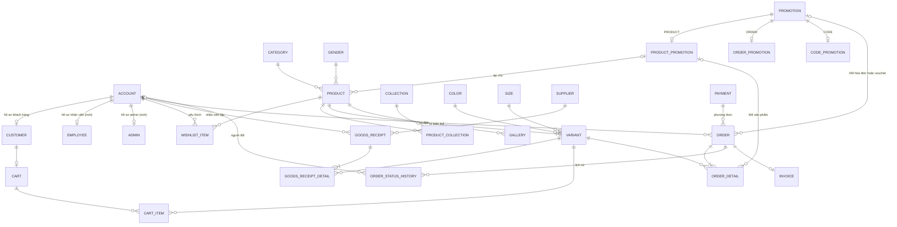

# Data Model v1 — Soobin Swimwear

## Metadata
- **Phiên bản:** v1
- **Status:** draft (chờ developer duyệt)
- **Nguồn:** ERD `sobin_erd_english_formatted.drawio` (source_of_true), [BR-GIAIDOAN1.md](../business-requirements/BR-GIAIDOAN1.md) (v8), [UC-01 → UC-40](../use-cases/README.md)
- **Nguyên tắc:** **ưu tiên ERD hiện tại, thay đổi càng ít càng tốt**. Chỉ thay đổi ERD ở những điểm developer đã chốt; nhu cầu khác của UC được đáp ứng bằng quy tắc nghiệp vụ hoặc giá trị tính toán, không thêm cột/bảng.

## 1. Quy ước

- Đây là **Entity Model** theo SDD Ebook (Tầng 3): tên gọi, ý nghĩa, trạng thái, quan hệ và quy tắc. Không nói về datatype, index — phần đó nằm ở ERD.
- Tên entity và field **giữ đúng tên bảng / cột trong ERD** (ví dụ `sales.order.order_status`). Field mới được đánh dấu **(mới)**.
- Tiền: số nguyên VND, làm tròn `ROUND_HALF_UP`. Phần trăm giảm: số thập phân. Thời gian: lưu UTC, hiển thị `Asia/Ho_Chi_Minh` (AGENTS.md).
- Mỗi bảng thuộc một bounded context; context khác chỉ tham chiếu bằng ID và truy cập qua Service công khai (AGENTS.md). Ký hiệu `→ <context>`.
- `[GD]`: giả định của agent, chờ developer quyết định.

## 2. Thay đổi so với ERD (chỉ các điểm đã chốt)

| # | Bảng | Thay đổi | Căn cứ |
|---|---|---|---|
| 1 | `auth.account` | Bỏ các cột thông tin cá nhân (`account_name`, `account_date_of_birth`, `account_house_number`, `account_ward`, `account_city`, `account_country`). Giữ `account_email`, `account_phone_number`, `account_hash_password`, `account_status`, `account_role_name`; `account_phone_number` thêm ràng buộc **duy nhất**. | Đã chốt: account chỉ giữ thông tin đăng nhập; đăng nhập bằng email hoặc SĐT (BR-001) |
| 2 | `customer.customer` | Thêm `customer_date_of_birth`. | Đã chốt: hồ sơ giữ họ tên, ngày sinh, địa chỉ |
| 3 | `auth.employee`, `auth.admin` (mới) | Hai bảng hồ sơ, cấu trúc giống `customer.customer`, khóa ngoại tới `account`. | Đã chốt (BR-001) |
| 4 | `inventory.variant` | Thêm `variant_cost_price` (giá vốn bình quân gia quyền). | Đã chốt (BR-005, BR-007) |
| 5 | `inventory.supplier` | Thêm `supplier_phone_number`, `supplier_email`, `supplier_address`. | Đã chốt (UC-32) |
| 6 | `inventory.supplier` | Thêm `supplier_status` (Đang hợp tác / Ngừng hợp tác). | Đã chốt (UC-32, UC-33) |

Mọi bảng và cột khác **giữ nguyên ERD**.

## 3. Sơ đồ quan hệ

Sơ đồ chỉ thể hiện quan hệ (theo ERD + các thay đổi ở mục 2), không thể hiện field.



## 4. Entity theo bounded context

| Bounded context | Bảng ERD |
|---|---|
| identity-context | `auth.account`, `customer.customer`, `auth.employee` (mới), `auth.admin` (mới) |
| catalog-context | `inventory.category`, `collection`, `gender`, `size`, `color`, `product`, `product_collection`, `variant`, `gallery`; `customer.wishlist_item` |
| checkout-context | `sales.cart`, `cart_item`, `order`, `order_detail`, `payment`, `order_status_history`, `invoice` |
| promotion-context | `promotion.promotion`, `product_promotion`, `order_promotion`, `code_promotion` |
| inventory-context | `inventory.supplier`, `goods_receipt`, `goods_receipt_detail`; cập nhật `variant_quantity`, `variant_cost_price` |
| shipping-context | Không có bảng riêng — dùng `sales.order.order_status` |
| reporting-context | Không có bảng riêng — view tổng hợp |

> ERD đặt bảng sản phẩm trong schema `inventory`; về nghiệp vụ, chúng thuộc catalog-context. Giữ nguyên schema ERD, chỉ phân quyền sở hữu theo context `[GD]`.

### 4.1. identity-context (BR-001)

#### Account — `auth.account`
- **Đại diện:** thông tin đăng nhập của một người dùng; không chứa thông tin cá nhân.
- **Field:** `account_id`, `account_email` (duy nhất), `account_phone_number` (duy nhất), `account_hash_password`, `account_status`, `account_role_name`
- **Vai trò:** Khách hàng | Nhân viên | Admin (ERD: `customer` / `employee` / `admin`). 3 vai trò cố định.
- **Trạng thái:** Hoạt động | Bị khóa.
- **Có một:** đúng 1 hồ sơ theo vai trò — `customer`, `employee` hoặc `admin`.
- **Quy tắc:**
  - Đăng nhập bằng email **hoặc** số điện thoại; đăng ký nhập đủ cả hai (UC-01, UC-02).
  - **Phiên đăng nhập — không thêm bảng** `[GD]`: lúc đăng nhập, hệ thống cấp token có chữ ký chứa `account_id` và vai trò. Mỗi request: (1) kiểm tra chữ ký token để biết là ai; (2) đọc `account_status`, `account_role_name` của `account_id` đó trong DB (1 truy vấn theo khóa chính). Tài khoản Bị khóa (UC-08) hoặc vai trò khác với vai trò trong token (UC-07) → từ chối, buộc đăng nhập lại. Đăng xuất (UC-03) xóa token phía trình duyệt; token có thời hạn ngắn.
  - Đổi vai trò chỉ giữa Nhân viên ↔ Admin: tạo hồ sơ ở bảng mới với cùng thông tin, xóa hồ sơ cũ, trong cùng một transaction `[GD]`.

#### Customer — `customer.customer`
- **Đại diện:** hồ sơ cá nhân của Khách hàng.
- **Field:** `customer_id`, `account_id` (duy nhất), `customer_name`, `customer_phone_number`, `customer_date_of_birth` **(mới)**, `customer_house_number`, `customer_ward`, `customer_city`, `customer_country`
- **Quy tắc:** đúng 1 địa chỉ nhận hàng, điền sẵn khi đặt hàng (UC-04, UC-19). `customer_phone_number` là SĐT nhận hàng mặc định, có thể khác SĐT đăng nhập `[GD]`.

#### Employee — `auth.employee` (mới) / Admin — `auth.admin` (mới)
- **Đại diện:** hồ sơ cá nhân của Nhân viên / Admin.
- **Field:** cấu trúc giống `customer.customer`: `employee_id` / `admin_id`, `account_id` (duy nhất), họ tên, số điện thoại, ngày sinh, địa chỉ (số nhà, phường/xã, tỉnh/thành phố, quốc gia).
- **Quy tắc:** hệ thống có sẵn 1 Admin khi khởi tạo `[GD]`.

### 4.2. catalog-context (BR-002)

#### Product — `inventory.product`
- **Đại diện:** một mẫu đồ bơi.
- **Field:** `product_id`, `product_name`, `product_description`, `product_status`, `product_updated_at`, `product_category_id`, `product_gender_id`, `product_promotion_id`; `product_total_score_review` giữ theo ERD nhưng **không dùng ở v1** (review để giai đoạn 2).
- **Trạng thái:** Đang bán | Ngừng bán.
- **Quan hệ:** đúng 1 `category`, đúng 1 `gender`, nhiều `collection` (qua `product_collection`), nhiều `variant`, nhiều `gallery`; tối đa 1 `product_promotion`.
- **Quy tắc:**
  - Chỉ chuyển Đang bán khi đã có biến thể và mọi size đã có giá `[GD]`.
  - **Bảng size:** dùng một bảng size chung cho cả cửa hàng, nội dung cố định như trang thông tin; không có cột riêng cho sản phẩm (đã chốt, UC-12, UC-14).

#### Variant — `inventory.variant`
- **Đại diện:** một tổ hợp **màu × size** của sản phẩm — đơn vị được bán, nhập kho và tính tồn.
- **Field:** `variant_id`, `variant_product_id`, `variant_color_id`, `variant_size_id`, `variant_quantity`, `variant_sell_price`, `variant_cost_price` **(mới)**, `variant_status`
- **Quy tắc:**
  - **Giá theo size — giữ `variant_sell_price`:** Nhân viên đặt giá theo size (UC-16); hệ thống ghi cùng một giá cho **mọi biến thể cùng sản phẩm và cùng size**. Cùng size khác màu luôn cùng giá (đã chốt).
  - `variant_quantity` không bao giờ âm, không sửa tay. Thay đổi khi: xác nhận phiếu nhập (+), tạo đơn (−), hủy / tự hủy đơn (+), giao không thành công (+).
  - `variant_cost_price`: bình quân gia quyền — `Giá vốn mới = (Giá trị tồn hiện tại + Tiền nhập lô này) / Tồn sau khi nhập`; tồn hiện tại = 0 thì bằng giá nhập lô mới; hàng hoàn không làm đổi giá vốn.
  - `variant_quantity`, `variant_cost_price` do inventory-context và checkout-context cập nhật qua Service công khai của catalog-context `[GD]`.

#### Gallery — `inventory.gallery`
- **Field:** `gallery_id`, `gallery_product_id`, `gallery_order_no`, `gallery_uri`
- **Quy tắc:** ảnh gắn theo sản phẩm, có thứ tự hiển thị; không theo màu (đã chốt).

#### Category / Collection / Gender / Size / Color
- **Field:** `<x>_id`, `<x>_name`
- **Quy tắc:** lọc trang danh mục theo giới tính, size, danh mục, bộ sưu tập (UC-10). Sản phẩm – bộ sưu tập là nhiều–nhiều qua `inventory.product_collection`.

#### WishlistItem — `customer.wishlist_item`
- **Field:** `wishlist_item_id`, `wishlist_item_account_id`, `wishlist_item_product_id`
- **Quy tắc:** mỗi sản phẩm 1 lần trong danh sách của một tài khoản. "Mới thêm nhất trước" sắp theo `wishlist_item_id` giảm dần — **không thêm cột thời gian** `[GD]`.

### 4.3. checkout-context (BR-003, BR-006)

#### Cart — `sales.cart` / CartItem — `sales.cart_item`
- **Field:** `cart_id`, `cart_account_id` (ERD: tham chiếu `customer.customer`); `cart_item_id`, `cart_item_cart_id`, `cart_item_variant_id`, `cart_item_quantity`
- **Quy tắc:** chỉ Khách hàng đăng nhập có giỏ trong DB; giỏ Khách vãng lai lưu trên trình duyệt `[GD]`. Mỗi biến thể 1 dòng trong giỏ. Giỏ không lưu giá, luôn hiển thị giá hiện tại `[GD]`.

#### Order — `sales.order`
- **Đại diện:** một lần Khách hàng đặt hàng.
- **Field:** `order_id`, `order_code` (mới), `order_customer_name`, `order_customer_phone_number`, `order_customer_house_number`, `order_customer_ward`, `order_customer_city`, `order_customer_country` (snapshot thông tin nhận hàng), `order_discount_amount`, `order_shipping_fee`, `order_total_price`, `order_payment_status`, `order_status`, `order_created_date`, `order_account_id`, `order_payment_id`, `order_promotion_id`
- **Trạng thái đơn (`order_status`):**
  ```
  Chưa xử lý ──(UC-23)──► Đã xác nhận ──(UC-40)──► Chờ lấy hàng ──(UC-36 "Đã nhận hàng")──► Đang giao ──(UC-36)──► Giao thành công
      │                         │                          │                                         └──(UC-36)──► Giao không thành công
      └─────────────────────────┴──────────────────────────┴──► Đã hủy
          (UC-22: khách hủy khi "Chưa xử lý"; Nhân viên hủy khi "Chưa xử lý" / "Đã xác nhận" / "Chờ lấy hàng"; UC-24: hệ thống tự hủy đơn QR quá hạn)
  ```
- **Trạng thái thanh toán (`order_payment_status`):** Chưa thanh toán | Đã thanh toán.
- **Giá trị tính toán — không thêm cột** `[GD]`:
  - Tạm tính = tổng (đơn giá sau KM sản phẩm × số lượng) của `order_detail`.
  - Hạn thanh toán đơn QR = `order_created_date` + 24 giờ.
- **Quy tắc:**
  - `order_total_price = tạm tính − order_discount_amount + order_shipping_fee`; phí vận chuyển là 1 mức cho mọi đơn, lấy từ biến môi trường (mặc định 12.000đ), lưu vào `order_shipping_fee` lúc đặt (đã chốt 20/11/2026).
  - **Mã đơn `order_code`** (đã chốt 20/11/2026): 8 ký tự ngẫu nhiên Crockford Base32 (`0123456789ABCDEFGHJKMNPQRSTVWXYZ`), sinh bằng `secrets`, UNIQUE, trùng thì sinh lại; tách khỏi `order_id`. Nội dung chuyển khoản = `SOBIE` + `order_code`.
  - `order_promotion_id`: tối đa 1 khuyến mãi — theo hóa đơn **hoặc** voucher.
  - Kiểm tra / trừ tồn kho, áp khuyến mãi / tăng lượt đã dùng và tạo đơn chạy trong **cùng một transaction** (AGENTS.md).
  - Hủy (khách, Nhân viên, hệ thống) → cộng lại tồn kho và hoàn lượt voucher / khuyến mãi theo hóa đơn (đã chốt). Không còn thao tác "Từ chối" và trạng thái "Bị từ chối" (đã chốt 20/11/2026).
  - **Cộng lại tồn khi giao không thành công chỉ một lần — không thêm cột đánh dấu** `[GD]`: trạng thái chỉ được chuyển "Đang giao → Giao không thành công" một lần, nên lần gửi thứ hai bị từ chối vì đơn không còn "Đang giao".
  - **Lý do hủy:** Nhân viên hủy bắt buộc nhập lý do qua popup; lưu ở `order_status_history_note` `[GD]`; chỉ Nhân viên xem, khách không thấy (đã chốt 20/11/2026).

#### OrderDetail — `sales.order_detail`
- **Field:** `order_detail_id`, `order_detail_order_id`, `order_detail_variant_id`, `order_detail_quantity`, `order_detail_unit_price`, `order_detail_product_promotion_id`
- **Quy tắc — không thêm cột giá sau giảm:**
  - `order_detail_unit_price` = đơn giá **gốc** theo size lúc đặt.
  - Đơn giá sau giảm = đơn giá gốc × (1 − `product_promotion_discount_percentage`) của khuyến mãi ghi trên dòng.
  - Giá trị này luôn ổn định vì **khuyến mãi đã tạo không được sửa** (đã chốt, xem 4.4).

#### Payment — `sales.payment`
- **Đại diện:** phương thức thanh toán: COD | Chuyển khoản QR.

#### OrderStatusHistory — `sales.order_status_history`
- **Field:** `order_status_history_id`, `order_status_history_order_id`, `order_status_history_from_value`, `order_status_history_to_value`, `order_status_history_source`, `order_status_history_note` (mới — lý do hủy), `order_status_history_changed_by`, `order_status_history_changed_time`
- **Nguồn:** Khách hàng | Nhân viên | Hệ thống | Trang giả lập vận chuyển.
- **Quy tắc:** ghi mọi lần đổi `order_status`. Thay đổi `order_payment_status` **không** ghi vào bảng này (đã chốt).

#### BankTransaction — `sales.bank_transaction` (mới)
- **Đại diện:** một giao dịch tiền vào tài khoản cửa hàng do SePay báo qua webhook (đã chốt 20/11/2026, BR-006).
- **Field:** `bank_transaction_id`, `bank_transaction_provider_id` (mã giao dịch SePay, UNIQUE), `bank_transaction_gateway`, `bank_transaction_account_number`, `bank_transaction_amount`, `bank_transaction_content`, `bank_transaction_reference_code`, `bank_transaction_time`, `bank_transaction_received_time`, `bank_transaction_match_status` (Khớp | Không khớp), `bank_transaction_order_id` (NULL khi không khớp), `bank_transaction_raw_payload` `[GD]`
- **Quy tắc:**
  - Webhook xác thực bằng API key nạp từ biến môi trường; sai khóa thì không ghi.
  - Khớp khi nội dung chứa `SOBIE` + `order_code` của đơn QR "Chưa xử lý", "Chưa thanh toán", còn hạn 24 giờ, và số tiền ≥ `order_total_price` → đơn chuyển "Đã thanh toán". Chuyển thừa vẫn khớp; chuyển thiếu là không khớp; mỗi giao dịch xét riêng, không cộng dồn.
  - Không khớp: đơn giữ nguyên; khách tự liên hệ cửa hàng. Khách chuyển lại đúng thì đơn tự cập nhật.
  - Cùng `bank_transaction_provider_id` chỉ xử lý 1 lần. Ghi giao dịch và cập nhật `order_payment_status` trong cùng transaction.

#### Invoice — `sales.invoice`
- **Field:** `invoice_id`, `invoice_order_id` (duy nhất), `invoice_snapshot_json`, `invoice_created_date`
- **Snapshot (theo ERD):** tên sản phẩm, đơn giá gốc, đơn giá sau giảm, số lượng, tiền giảm, phí vận chuyển, tổng thanh toán, địa chỉ, người đặt, SĐT, email, phương thức thanh toán.
- **Quy tắc:** tự xuất khi giao thành công; mỗi đơn tối đa 1 hóa đơn. Mã hóa đơn hiển thị sinh từ `invoice_id` `[GD]`.

### 4.4. promotion-context (BR-004)

#### Promotion — `promotion.promotion` (supertype)
- **Field:** `promotion_id`, `promotion_type` (`PRODUCT` | `ORDER` | `CODE`), `promotion_quantity` (số lượng được áp dụng), `promotion_used_amount` (số đã dùng), `promotion_start_date`, `promotion_end_date`, `promotion_status`
- **Trạng thái:** Sắp diễn ra | Đang hiệu lực | Đã kết thúc `[GD]`.
- **Quy tắc:**
  - Giảm theo **phần trăm**, không có mức tối đa.
  - **Khuyến mãi đã tạo không được sửa** — chỉ có thể **ngừng** để các đơn sau không được áp; đơn đã tạo không đổi (đã chốt).
  - **Khi tạo, hệ thống hiển thị popup xác nhận** tóm tắt thông tin khuyến mãi; chỉ lưu khi Nhân viên bấm xác nhận (đã chốt).
  - Ngừng: ghi `promotion_end_date` = thời điểm ngừng, chuyển "Đã kết thúc".
  - Không có tên — nhận diện bằng `promotion_id` (voucher thêm `code_promotion_code`). Danh sách lọc được theo khoảng thời gian dựa trên `promotion_start_date`, `promotion_end_date`: hiển thị khuyến mãi có thời gian hiệu lực giao với khoảng đã chọn (kể cả giao một phần); khuyến mãi chưa kết thúc (chưa có `promotion_end_date`) coi như còn hiệu lực đến hiện tại (đã chốt).

#### ProductPromotion — `promotion.product_promotion`
- **Field:** `promotion_id`, `product_promotion_discount_percentage`
- **Quy tắc:** không dùng `promotion_quantity`; hiệu lực đến khi Nhân viên bấm kết thúc (ngừng) chương trình (đã chốt). Mỗi sản phẩm tối đa 1 khuyến mãi theo sản phẩm.

#### OrderPromotion — `promotion.order_promotion`
- **Field:** `promotion_id`, `order_promotion_discount_percentage`, `order_promotion_thresh_price`
- **Quy tắc:** mỗi đơn được áp tính 1 lượt; hết lượt thì không còn được xét.

#### CodePromotion (voucher) — `promotion.code_promotion`
- **Field:** `promotion_id`, `code_promotion_code` (duy nhất), `code_promotion_discount_percentage`, `code_promotion_thresh_price`
- **Quy tắc:** chỉ giới hạn tổng lượt (`promotion_quantity`), không giới hạn mỗi khách.

#### Quy tắc chọn mức giảm (UC-31)
- Mỗi đơn tối đa 1: KM theo hóa đơn **hoặc** voucher — chọn cái có lợi hơn; bằng nhau ưu tiên **voucher** (đã chốt). KM theo sản phẩm tính cùng mức giảm được chọn.
- Chỉ hợp lệ khi tạm tính ≥ `thresh_price`, đang hiệu lực và còn lượt.

### 4.5. inventory-context (BR-005)

#### Supplier — `inventory.supplier`
- **Field:** `supplier_id`, `supplier_name`, `supplier_phone_number` **(mới)**, `supplier_email` **(mới)**, `supplier_address` **(mới)**, `supplier_status` **(mới)**
- **Trạng thái:** Đang hợp tác | Ngừng hợp tác (đã chốt).
- **Quy tắc:** chỉ nhà cung cấp Đang hợp tác được chọn khi lập phiếu nhập. Nhà cung cấp đã có phiếu nhập không xóa được, chỉ ngừng hợp tác `[GD]`.

#### GoodsReceipt — `inventory.goods_receipt`
- **Field:** `goods_receipt_id`, `goods_receipt_final_price`, `goods_receipt_status`, `goods_receipt_created_date`, `goods_receipt_supplier_id`, `goods_receipt_account_id` (Nhân viên lập)
- **Trạng thái `[GD]`:** Nháp → Đã xác nhận | Đã hủy.
- **Quy tắc:** xác nhận phiếu cộng tồn và tính lại `variant_cost_price` trong cùng một transaction. Không lưu người / thời điểm xác nhận (đã chốt).

#### GoodsReceiptDetail — `inventory.goods_receipt_detail`
- **Field:** `goods_receipt_detail_id`, `goods_receipt_detail_goods_receipt_id`, `goods_receipt_detail_variant_id`, `goods_receipt_detail_quantity`, `goods_receipt_detail_actual_unit_price`, `goods_receipt_detail_total_price`

### 4.6. shipping-context và reporting-context

- **shipping-context:** không có bảng riêng. UC-40 (Nhân viên bàn giao → "Đang giao") và UC-36 (trang giả lập → "Giao thành công" / "Giao không thành công") chỉ đổi `sales.order.order_status`.
- **reporting-context:** dashboard (UC-37) là view tổng hợp:
  - Doanh thu, lợi nhuận gộp, sản phẩm bán chạy: `order` "Giao thành công" + `order_detail` + `variant_cost_price`.
  - Số đơn theo trạng thái: `order`.
  - Tồn kho thấp: `variant_quantity` ≤ ngưỡng hard-code.
  - Tiền nhập hàng theo nhà cung cấp: `goods_receipt` "Đã xác nhận".

## 5. Giá trị cố định (hard-code, không phải bảng)

| Giá trị | Dùng ở |
|---|---|
| Phí vận chuyển cố định cho mọi đơn — biến môi trường, mặc định 12.000đ | UC-19, UC-20, UC-31 |
| Hotline, link Zalo | UC-09 |
| Thông tin người gửi | UC-36, UC-40 |
| Tài khoản nhận chuyển khoản (sinh mã QR) | UC-20 |
| Ngưỡng tồn kho thấp | UC-37, UC-39 |
| Nội dung trang giới thiệu, chính sách, FAQ; bảng size chung | UC-12, UC-13 |

## 6. Mã trạng thái đề xuất `[GD]` (giá trị cột varchar, không đổi ERD)

| Cột | Giá trị nghiệp vụ → mã |
|---|---|
| `account_role_name` | Khách hàng `customer`, Nhân viên `employee`, Admin `admin` (theo ERD) |
| `account_status` | Hoạt động `ACTIVE`, Bị khóa `LOCKED` |
| `product_status` | Đang bán `ACTIVE`, Ngừng bán `INACTIVE` |
| `order_status` | Chưa xử lý `PENDING`, Đã xác nhận `CONFIRMED`, Chờ lấy hàng `AWAITING_PICKUP`, Đang giao `SHIPPING`, Giao thành công `DELIVERED`, Giao không thành công `DELIVERY_FAILED`, Đã hủy `CANCELLED` |
| `bank_transaction_match_status` | Khớp `MATCHED`, Không khớp `UNMATCHED` |
| `order_payment_status` | Chưa thanh toán `UNPAID`, Đã thanh toán `PAID` |
| `payment_name` | `COD`, `QR` |
| `order_status_history_source` | `CUSTOMER`, `EMPLOYEE`, `SYSTEM`, `SHIPPING_SIMULATOR` |
| `promotion_type` | `PRODUCT`, `ORDER`, `CODE` (theo ERD) |
| `promotion_status` | Sắp diễn ra `UPCOMING`, Đang hiệu lực `ACTIVE`, Đã kết thúc `ENDED` |
| `goods_receipt_status` | Nháp `DRAFT`, Đã xác nhận `CONFIRMED`, Đã hủy `CANCELLED` |
| `supplier_status` | Đang hợp tác `ACTIVE`, Ngừng hợp tác `INACTIVE` |

## 7. Quyết định đã chốt khi đối chiếu ERD (15/11/2026)

| # | Chủ đề | Quyết định | UC liên quan |
|---|---|---|---|
| 1 | Bảng size | Một bảng size chung, nội dung cố định | UC-12, UC-14 |
| 2 | Lý do từ chối đơn | Bỏ — không nhập, không lưu. Cập nhật 20/11/2026: bỏ hẳn thao tác từ chối; Nhân viên hủy đơn phải nhập lý do | UC-22, UC-23 |
| 3 | Trạng thái nhà cung cấp | Có: Đang hợp tác / Ngừng hợp tác (thêm `supplier_status`) | UC-32, UC-33 |
| 4 | Người / thời điểm xác nhận phiếu nhập | Không lưu | UC-34 |
| 5 | Lịch sử trạng thái thanh toán | Không ghi (giao dịch tiền vào được lưu ở `bank_transaction`) | UC-25, UC-26 |
| 6 | Sửa khuyến mãi | Không được sửa, chỉ ngừng; khi tạo có popup xác nhận | UC-28 → UC-31 |
| 7 | Tên khuyến mãi | Không có tên (giữ ERD); danh sách lọc theo khoảng thời gian | UC-28, UC-29, UC-30 |

Giả định `[GD]` còn lại của data model: cơ chế kiểm tra phiên mỗi request, mã trạng thái (mục 6), cách sinh mã hóa đơn từ ID, danh sách cột `bank_transaction`, vị trí lưu lý do hủy, phân quyền sở hữu bảng theo context. Giả định chi tiết của từng UC xem [README use case](../use-cases/README.md).

## History
- v1 (2026-11-15): initial — bám sát ERD; thay đổi 6 điểm đã chốt (account, customer, employee, admin, variant_cost_price, supplier)
- v2 (2026-11-20): theo BR-GIAIDOAN1 v15 — `order_code` Crockford Base32, trạng thái Chờ lấy hàng, bỏ Bị từ chối, Nhân viên hủy có lý do, bảng `bank_transaction` (SePay), phí vận chuyển từ biến môi trường
